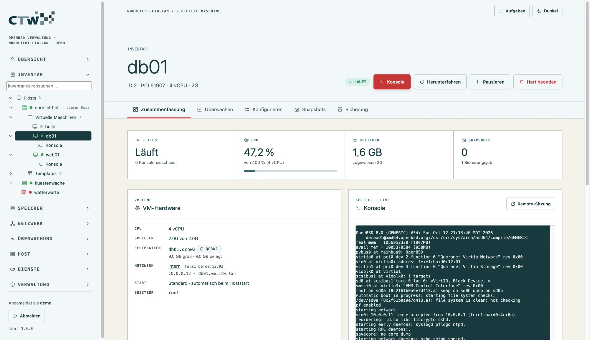

# maar

**Webbasierte Verwaltung für OpenBSD** – virtuelle Maschinen, Speicher, Netzwerk und Host in einer
Oberfläche, aufgebaut nach dem Vorbild des vSphere Clients. Ein einziges statisches Go-Binary, auf dem
Host wird außer dem Basissystem nichts benötigt.

[](https://github.com/thorin-eifel/maar/releases/latest)



- **Virtualisierung mit vmd:** VMs anlegen und bedienen, Templates und verknüpfte Klone, Snapshots,
  Backups mit Zeitplan, serielle Konsolen im Browser mit Live-Vorschau.
- **Netz und Speicher als Konzept, nicht als Datei:** Portgruppen mit VLAN, NAT, DHCP und DNS,
  Firewall je VM, geteilter Speicher (iSCSI, Fibre Channel) mit Datastores.
- **Formulare statt Konfigurationsdateien:** Auswahlfelder mit dem, was es auf dem Host wirklich gibt;
  maar schreibt, prüft und sichert die Dateien im Hintergrund.
- **Kein Aussperren:** Änderungen an pf und Netzwerk gelten *auf Probe* und werden ohne Bestätigung
  automatisch zurückgenommen.
- **Mehrere Hosts** in einer Übersicht, Rollen mit VM-Eingrenzung, Ereignisprotokoll, Mail-Alarme.

## Schnellstart

Als root auf dem OpenBSD-Host (amd64 oder arm64):

```sh
ftp -o - https://github.com/thorin-eifel/maar/releases/latest/download/install.sh | sh
```

Das Skript lädt die passende Version aus dem Release, prüft sie gegen `SHA256`, installiert
`/usr/local/sbin/maard` und `/etc/rc.d/maard` und startet den Dienst. Danach ist die Oberfläche unter
`https://<host>:9443` erreichbar (selbst signiertes Zertifikat); anmelden können sich alle Konten der
Gruppe `wheel` mit ihrem Systempasswort.

Derselbe Befehl aktualisiert eine vorhandene Installation. Mit `MAAR_VERSION=1.0.0` wählst du eine
bestimmte Version, mit `MAAR_FLAGS="-listen 192.168.50.10:9443"` setzt du bei der Erstinstallation die
Startoptionen.

**Erst ausprobieren?** Auf jedem Mac oder Linux mit Go läuft ein simulierter Host:

```sh
make demo
```

Öffnet <http://127.0.0.1:9443> (Anmeldung `demo` / `demo`). Konfigurationsdateien liegen in einer
temporären Sandbox, die VM-Konsolen sind simuliert.

## Inhalt

- [Funktionen im Überblick](#funktionen-im-überblick)
- [Virtuelle Maschinen](#virtuelle-maschinen): [Templates](#templates-und-gastanpassung) ·
  [Snapshots](#snapshots) · [Backup](#backup) · [Leistung & Alarme](#leistung--alarme)
- [Netzwerk und Speicher](#netzwerk-und-speicher): [VM-Netze](#vm-netze) · [Geteilter Speicher](#geteilter-speicher)
- [Host-Einstellungen per Formular](#host-einstellungen-per-formular)
- [Zugriff und mehrere Hosts](#zugriff-und-mehrere-hosts)
- [Installation und Betrieb](#installation-und-betrieb) · [Sicherheit](#sicherheit) · [Entwicklung](#entwicklung) · [Grenzen](#grenzen-dieser-version)

## Funktionen im Überblick

Das Menü ist nach Aufgaben geordnet: **Übersicht**, **Inventar** (Hosts, VMs, Templates), **Speicher**,
**Netzwerk**, **Überwachung**, **Host**, **Dienste** und **Verwaltung**. Das Inventar erscheint als Baum
direkt im Menü (Hosts → VMs mit Konsole, Datastores unter Speicher, Portgruppen unter Netzwerk) mit
Suche und Tastatursteuerung; Menügruppen lassen sich einklappen. Snapshots liegen wie in vSphere an der
einzelnen VM.

| Bereich | Was geht | Werkzeuge darunter |
|---|---|---|
| Übersicht | CPU, Speicher, Laufzeit, Dateisysteme, VMs, ausgefallene Dienste, pf-Status | `sysctl`, `top -b`, `df`, `ifconfig` |
| Virtuelle Maschinen | anlegen, starten, von ISO starten, herunterfahren, hart beenden, pausieren, bearbeiten, löschen; Disk-Images (auch qcow2-Overlay); ISOs herunterladen/hochladen | `vmctl`, `/etc/vm.conf`, `vmd -n` |
| Templates | Bibliothek schreibgeschützter Basisimages, Bereitstellung als verknüpfter Klon oder Vollkopie, Gastanpassung | `vmctl create -b/-i`, qcow2-Header |
| Snapshots, Backup | Offline-Snapshots als qcow2-Kette, Backup-Jobs mit Zeitplan, Wiederherstellen | `vmctl`, `qemu-img` (optional) |
| Konsolen | serielle VM-Konsole, geteilt zwischen Administratoren, Live-Vorschau auf der VM-Seite; Login-Shell auf dem Host | TTY der VM, `su -l` im PTY |
| Leistung & Alarme | Verlauf für Host und VMs, Alarmregeln, Mail-Benachrichtigung | `sysctl`, `vmstat`, `netstat`, `ps`, `mail(1)` |
| VM-Netze | Portgruppen auf `veb` mit VLAN/Uplink, NAT, DHCP, DNS, Firewall je VM | `veb(4)`, `vlan(4)`, `dhcpd`, `unbound`, pf |
| Geteilter Speicher | iSCSI-Ziele, Fibre-Channel-HBAs, SAN-Disks, Datastores | `iscsid`, `iscsictl`, `disklabel`, `newfs` |
| Netzwerk, Paketfilter | Schnittstellen, Routen, Resolver; pf-Regeln, Tabellen, States | `ifconfig`, `netstat`, `pfctl` |
| Dienste, Pakete | `rcctl`-Dienste; Pakete, `syspatch`, `fw_update`, `sysupgrade -n` | `rcctl`, `pkg_add`, `pkg_info` |
| Benutzer, System | Konten, Gruppen, crontab; Prozesse, Dateisysteme, sysctl, Neustart | `useradd`, `usermod`, `ps`, `disklabel` |
| Konfiguration | Formulare für ntpd, resolv.conf, hosts, sshd, doas, pf, httpd, smtpd, relayd, sysctl, Interfaces; 24 weitere Dateien als Text mit Syntaxprüfung | `pfctl -nf`, `httpd -n`, `doas -C`, `sshd -t`, … |
| Protokolle, Ereignisse | `/var/log/*` lesen und live verfolgen; Ereignisprotokoll aller Aktionen | Server-Sent Events |
| Zugriff, Hosts | Rollen, API-Token, mehrere maard-Instanzen in einer Übersicht | `/var/maar/*.json` |

Lang laufende Befehle (Pakete, Patches, Upgrades, Downloads, Backups) laufen als **Aufgaben** im
Hintergrund; ihre Ausgabe erscheint live in der Aufgabenleiste oben rechts.

## Virtuelle Maschinen

Die **VM-Detailseite** hat die Reiter Zusammenfassung (Status, CPU, Speicher, Hardware, Netz, Firewall,
Sicherung, Ereignisse und eine kleine Live-Vorschau der Konsole, die per Klick eine Remote-Sitzung in
einem neuen Tab öffnet), Überwachen, Konfigurieren, Snapshots und Sicherung. Die Reiter sind verlinkbar
(`#/vm/<name>/<reiter>`). **Datastore- und Portgruppen-Seiten** zeigen „Verwendet von“: welche VMs auf
einem Datastore liegen oder an einer Portgruppe hängen.

### Templates und Gastanpassung

Templates liegen als schreibgeschützte qcow2-Images mit JSON-Beschreibung unter `<vmdir>/templates`.
Eine Bereitstellung legt die Disk an (`vmctl create -b` für verknüpfte Klone, `-i` für Vollkopien),
erzeugt bei Bedarf eine Seed-ISO (Label `CIDATA`), trägt die VM in `vm.conf` ein und startet sie.
Welche VMs auf einem Template aufbauen, liest maar direkt aus dem qcow2-Header.

- **Linux-Gäste:** Cloud-Images mit cloud-init werten die Seed-ISO automatisch aus.
- **OpenBSD-Gäste:** Im Template einmalig [`maar-guest`](web/guest/maar-guest.sh) installieren
  (die Templates-Seite zeigt die Befehle). Hostname, Netz, Benutzer, SSH-Schlüssel und neue
  Hostschlüssel werden beim ersten Start gesetzt; das Passwort liegt nur als bcrypt-Hash vor.

Klone einer laufenden VM sind nicht möglich; VM-Klone sind immer Vollkopien.

### Snapshots

Snapshots liegen unter `<vmdir>/snapshots/<vm>/<id>/diskN.qcow2` (schreibgeschützt). Beim Anlegen wird
die aktive Disk dorthin verschoben und durch ein leeres Overlay ersetzt – der Pfad in `vm.conf` bleibt
gleich, die Dauer ist unabhängig von der Diskgröße. Die Baumstruktur liest maar aus den qcow2-Headern,
nicht aus einer eigenen Datenbank. Alle Vorgänge verlangen eine gestoppte VM (vmd kennt keine
Live-Snapshots).

| Vorgang | Ohne qemu-img | Mit qemu-img |
|---|---|---|
| Anlegen, Zurücksetzen, Umbenennen, Blatt löschen | ✓ | ✓ |
| Snapshot mit Nachfolgern zusammenführen | – | ✓ (`qemu-img rebase`) |
| Alle konsolidieren | ✓, Disk wird eigenständig | ✓, Template-Basis bleibt |

### Backup

Eine Sicherung liegt auf dem Ziel unter `<vm>/<JJJJMMTT-hhmmss>/` als `manifest.json` und
`diskN.qcow2`. Die Disks sind vollständig zusammengeführte, eigenständige Images – sie lassen sich ohne
Template, Snapshots oder maar einsetzen.

| Modus (laufende VM) | Ablauf | Ausfall |
|---|---|---|
| **Snapshot** (empfohlen) | herunterfahren → als Snapshot `maar-backup` einfrieren → starten → aus dem Snapshot sichern | Herunterfahren + Booten |
| Offline | herunterfahren → sichern → starten | gesamte Kopierdauer |
| Pause | pausieren → sichern → fortsetzen (absturzkonsistent) | VM steht während der Kopie |

Der Snapshot-Modus braucht `qemu-img` und qcow2-Disks, sonst sichert maar offline und vermerkt das.

- **Ziele:** lokal (eigene Platte empfohlen), NFS (pro Lauf eingehängt) oder SFTP (eigener Schlüssel
  `/var/maar/backup_ed25519`, die Oberfläche zeigt den öffentlichen Teil).
- **Zeitpläne** (stündlich, täglich, wöchentlich, manuell) laufen im Dienst; verpasste Termine werden
  einmal nachgeholt. Aufbewahrung je Job.
- **Wiederherstellen** als neue, nicht automatisch startende VM (standardmäßig ohne Netz, gegen
  IP-Konflikte) oder über die gestoppte VM – vorher sichert maar deren Zustand als Snapshot.

### Leistung & Alarme

maar misst alle 10 Sekunden mit leichtgewichtigen Zählern: CPU aus `kern.cp_time`, aktiven Speicher aus
`vmstat -s`, Netz aus `netstat -ibn` (physisch oder je VM-Tap) und CPU/RSS der vmd-Prozesse aus `ps`.
Die Zeitreihen (2 h in 10-s-Schritten, 7 Tage als 5-min-Mittel) liegen im Speicher und werden alle
5 Minuten gesichert. Disk-I/O je VM stellt vmd nicht bereit.

- **Regeln** vergleichen einen Messwert (`*` für „jede VM“) mit einem Schwellwert und lösen erst nach
  der Mindestdauer aus. Voreingestellt: Host-CPU und -Speicher > 90 % für 5 min, Dateisystem > 90 %,
  VM-CPU > 95 % für 15 min.
- **Ereignisse:** Dienst ausgefallen, VM unerwartet gestoppt (Stopps über maar zählen nicht), Sicherung
  fehlgeschlagen; optional „Zugriff verweigert“ und „Anmeldung fehlgeschlagen“.
- **Mail** geht über `mail(1)` an lokale Konten oder Adressen, gleiche Meldungen höchstens alle 30 Minuten.

## Netzwerk und Speicher

### VM-Netze

Die Absicht steht in `/var/maar/network.json`, alles andere wird daraus erzeugt – mit Prüfung und
Sicherung:

| Erzeugt | Inhalt |
|---|---|
| `/etc/hostname.vebN`, `.vportN`, `.vlanN` | Switch mit Mitgliedern, Gateway-Adresse, VLAN auf dem Uplink |
| `/etc/vm.conf` | `switch`-Blöcke mit `locked lladdr`, Anschlüsse der VMs mit fester MAC |
| `/etc/dhcpd.conf` | eigener Bereich zwischen `# >>> maar` und `# <<< maar`, automatische Reservierungen |
| `/var/unbound/etc/maar.conf` | Zonen sowie A- und PTR-Einträge der VMs |
| `/etc/pf.maar.conf` | Anker `maar` (NAT, DHCP/DNS, Firewall je VM) |

Bestehende Switches aus `vm.conf` werden als „vorgefunden“ übernommen; erst beim Speichern schreibt maar
ihre Dateien. Ungetaggte Uplinks dürfen keine eigene IP haben.

### Geteilter Speicher

| Transport | Stand unter OpenBSD 8.0 | Was maar tut |
|---|---|---|
| iSCSI | Initiator `iscsid(8)`, gesteuert mit `iscsictl(8)` | Ziele als Block `# >>> maar` in `/etc/iscsi.conf` (Syntaxprüfung `iscsid -nf`), iscsid aktivieren, `iscsictl reload`; von Hand eingetragene Ziele bleiben unangetastet |
| Fibre Channel | HBA-Treiber `qla`, `qlw`, `qle`; LUNs erscheinen als `sd`-Geräte | zeigt HBAs, WWPN (für Zoning und LUN-Masking) und LUNs; auf dem Host gibt es dafür keine Konfiguration |
| NVMe over Fabrics | **nicht vorhanden** – `nvme(4)` bedient nur lokale PCIe-Laufwerke | zeigt das offen als Hinweis |

**Datastores:** Eine freie SAN-Disk wird mit GPT, Label und FFS initialisiert und unter
`/var/vmd/<name>` eingehängt (fstab-Eintrag mit `noauto`). VM-Disks dürfen dort liegen; beim Anlegen
eines Images wählst du den Speicherort.

**Schutz vor Datenverlust:** Initialisiert werden nur Disks mit Transport iSCSI, FC oder Multipath –
lokale Disks, die Systemdisk, eingehängte Disks und Disks in `/etc/fstab` nie. Eine Disk mit Label wird
gesondert gewarnt, die Bestätigung verlangt den Gerätenamen. Ein Datastore lässt sich nicht aushängen,
solange VMs darauf laufen, und nicht entfernen, solange VMs seine Images verwenden.

Grenzen: FFS ist kein Cluster-Dateisystem – ein Datastore gehört immer nur **einem** Host (VM-Migration
zwischen Hosts gibt es daher noch nicht). Nach einem Neustart sind Datastores ausgehängt, weil iSCSI beim
Booten noch fehlt. CHAP wird noch nicht gesetzt (die Syntax ist in `iscsi.conf(5)` nicht belegt).

## Host-Einstellungen per Formular

Wo es geht, ändert maar Einstellungen über Formulare mit Auswahlfeldern, die nur Werte anbieten, die es
auf dem Host gibt. Jedes Formular zeigt eine **Vorschau** der Datei, schreibt erst beim Speichern, prüft
die Syntax, sichert die alte Fassung und lädt den Dienst neu. Kommentare und Zeilen, die das Formular
nicht kennt, bleiben unverändert. Das Bearbeiten als Text bleibt für Experten erreichbar.

**VM-Einstellungen:** Arbeitsspeicher (Vorgaben bis zum Hostspeicher), vCPUs, SEV/SEV-ES (nur auf
AMD-Hosts), Festplatten (nur freie Images, Reihenfolge per Pfeil, „Neues Image …“), CD-ROM aus vorhandenen
ISOs, Boot-Gerät, Besitzer aus den Konten des Hosts. Der Server prüft alles noch einmal: Disks anderer
VMs, Pfade außerhalb von `/var/vmd`, unbekannte Konten oder zu viel Speicher werden abgelehnt.

| Formular | Auswahl und Schutz |
|---|---|
| **ntpd.conf** | Server oder Pool mit Gewicht, nur tatsächlich vorhandene Zeit-Sensoren, Constraints, `listen on` mit den Adressen des Hosts; Status aus `ntpctl` |
| **resolv.conf** | bis zu 5 Nameserver (laufender Resolver, Gateway, öffentliche), Suchdomänen, `lookup`, `family`, `ndots`; Warnung bei `resolvd` |
| **hosts** | Tabelle der Einträge, VM-Adressen aus den VM-Netzen übernehmen; `localhost` bleibt immer erhalten |
| **sshd_config** | Anmeldemethoden, `AllowUsers`/`AllowGroups` aus den Konten, Ports, `ListenAddress`; **schützt vor dem Aussperren** (keine Anmeldemethode übrig, du nicht mehr zugelassen, Passwort aus ohne Schlüssel); Match-Blöcke bleiben |
| **sysctl.conf** | häufige Parameter mit Beschreibung, Wertebereich und Sicherheitshinweis, nur was der laufende Kernel kennt; Suche über alle; Prüfung auf Schreibbarkeit; optional sofort anwenden |
| **Netzwerk-Interfaces** | `hostname.<if>`: IPv4 per DHCP oder fest, Aliase, Gateway, IPv6, MTU, Beschreibung, VLANs; Prüfung auf doppelte Adressen und Gateway im eigenen Netz |
| **pf-Regeln** | Aktion, Richtung, Interface aus `ifconfig`, Protokoll, Von/Nach mit vorhandenen Tabellen, Ports, `quick`, `log`, Reihenfolge, Klartext je Regel; maar verwaltet einen eigenen Block in `pf.conf` |
| **doas** | Konto oder Gruppe, Zielbenutzer, Befehle des Hosts, `nopass`, `persist`, …; jede Regel als deutscher Satz, `doas -C` vor dem Speichern |
| **httpd** | Webseiten mit Adressen, TLS-Zertifikat aus `/etc/ssl`, Wurzelverzeichnis, Weiterleitung, HSTS; `location`- und `fastcgi`-Blöcke bleiben erhalten |
| **smtpd** | Zertifikate, Tabellen, Annahme, Zustellung (mbox, Maildir, LMTP, Relay), Regeln als deutsche Sätze; **offene Relays werden abgelehnt** |
| **Mail-Adressen** | Aliase und virtuelle Adressen als Tabelle, Schleifen und unbekannte Ziele werden abgelehnt; Tabellen mit Passwort-Hashes werden bewusst nicht angezeigt |
| **relayd** | Zieltabellen mit VM-Adressen, Relays (Schicht 7) und Weiterleitungen (Schicht 3), Zustandsprüfung per Ping, TCP, TLS oder HTTP; Protokolle aus Vorlagen |

**Auf Probe:** Änderungen an **pf-Regeln** und **Netzwerk-Interfaces** gelten zunächst 60 Sekunden. Antwortet
die Seite danach noch, bestätigst du; sonst stellt maar die alten Dateien und den alten Regelsatz selbst
wieder her – auch wenn `maard` in der Zwischenzeit beendet wird (Wiederherstellung beim Start).

## Zugriff und mehrere Hosts

### Rollen und Ereignisse

Die Gruppe (`-group`, Standard `wheel`) entscheidet, wer sich anmelden darf; die Rolle, was danach
erlaubt ist.

| Rolle | Darf |
|---|---|
| Administrator | alles |
| Operator | lesen; zugewiesene VMs starten, herunterfahren, pausieren, per Konsole bedienen; Snapshots anlegen und zurücksetzen |
| Betrachter | nur lesen – ohne Konfigurationsdateien, Schlüssel, Konsolen und Rollenverwaltung |

Ist ein Konto auf bestimmte VMs eingegrenzt, sieht und bedient es nur diese. Eine Änderung der eigenen
Rolle, die den Administrator-Zugriff entzieht, wird abgelehnt. Jede Anmeldung, verändernde Aktion und
verweigerte Anfrage landet im Ereignisprotokoll (`/var/maar/events.jsonl`) und im Syslog; das Ende von
Aufträgen erscheint als Ereignis.

### Mehrere Hosts

Jeder Host betreibt sein eigenes `maard` und wird lokal verwaltet. Ein beliebiger maard dient als
Zentrale und fragt die anderen (Peers) **lesend** ab – VMs, Leistung und Ereignisse aller Hosts in einer
Übersicht.

1. Auf dem Peer unter „Verwaltung → Zugriffssteuerung → API-Token“ ein Token anlegen (wird nur einmal
   angezeigt, gespeichert wird nur der SHA-256-Wert).
2. In der Zentrale unter „Hosts → Host verbinden“ Adresse, Name und Token eintragen und den
   **Fingerabdruck** des Zertifikats bestätigen. Ändert sich das Zertifikat später, meldet die Zentrale
   „Zertifikat geändert“, statt blind zu vertrauen.

Token dürfen nur die Zusammenfassung und Messwerte lesen (alles andere: 403). Peers werden nur über https
angesprochen. Verwaltungsaktionen gibt es über die Zentrale bewusst nicht – dafür ist jeder Host selbst
zuständig.

## Installation und Betrieb

Der Schnellstart steht oben. Alternativ von Hand: auf dem Mac/Linux cross-kompilieren
(`make release` erzeugt zusätzlich die Prüfsummen)

```sh
make openbsd
```

und auf den Host kopieren, oder dort direkt bauen (`pkg_add go`, dann im Quellverzeichnis `make install`):

```sh
scp build/maard-openbsd-amd64 root@host:/usr/local/sbin/maard
scp etc/rc.d/maard root@host:/etc/rc.d/maard
```

Auf dem Host als root:

```sh
chmod 0555 /usr/local/sbin/maard /etc/rc.d/maard
install -d -m 0700 /var/maar/backups
rcctl enable maard
rcctl set maard flags -listen 192.168.50.10:9443
rcctl start maard
```

Beim ersten Start wird ein selbst signiertes Zertifikat unter `/etc/ssl/maar.crt` bzw.
`/etc/ssl/private/maar.key` erzeugt. Ein eigenes Zertifikat (z. B. von `acme-client`) gibst du mit
`-cert` und `-key` an. Angemeldet wird über BSD Auth (`login_passwd`).

### Optionen

| Flag | Standard | Bedeutung |
|---|---|---|
| `-listen` | `:9443` | Adresse und Port |
| `-cert`, `-key` | `/etc/ssl/maar.crt`, `/etc/ssl/private/maar.key` | TLS; fehlende Dateien werden selbst signiert erzeugt |
| `-plain-http` | aus | ohne TLS, nur hinter `relayd` auf `127.0.0.1` sinnvoll |
| `-group` | `wheel` | Gruppe mit Anmelderecht |
| `-vmdir` | `/var/vmd` | Disk-Images; ISOs in `<vmdir>/iso` |
| `-no-pledge` | aus | `pledge(2)` abschalten (zur Fehlersuche) |
| `-demo` | aus | simulierter Host |

### pf

Den Zugang auf das Verwaltungsnetz beschränken, z. B.:

```
table <admin> const { 192.168.50.0/24 }
pass in on egress proto tcp from <admin> to (egress) port 9443
```

## Sicherheit

- Läuft als root (Systemverwaltung und BSD Auth brauchen das) und schränkt sich nach dem Start mit
  `pledge(2)` ein. Gestartete Werkzeuge laufen ohne zusätzliche Einschränkung.
- Alle Systemaufrufe gehen über Argumentlisten (`exec`), **nie über eine Shell**; jeder Name, Pfad und
  jede Größe wird vorher gegen eine Positivliste geprüft. Pfade für Disk-Images und ISOs müssen unter
  `-vmdir` liegen, Konfigurationsdateien müssen freigegeben sein.
- Sitzungen: zufälliges 256-Bit-Token im Cookie (`HttpOnly`, `Secure`, `SameSite=Strict`), 30 Minuten
  Leerlauf, maximal 12 Stunden. Jede schreibende Anfrage verlangt zusätzlich ein CSRF-Token;
  WebSockets prüfen den Origin.
- Anmeldung: 5 Fehlversuche je Quelladresse in 5 Minuten, danach Sperre.
- Strenge Content-Security-Policy (`script-src 'self'`), keine Inline-Skripte, Ausgaben des Systems
  werden nur als Text ins DOM gesetzt.
- Jede verändernde Aktion wird mit Benutzer und Quelladresse über syslog (`daemon.info`, Tag `maar`)
  protokolliert.
- Gefährliche Aktionen (VM löschen, pf aus, Neustart, Snapshot-Upgrade) verlangen das Abtippen eines
  Bestätigungsworts; Aktionen, die den eigenen Zugang kappen könnten, warnen ausdrücklich.
- Die Host-Shell läuft als angemeldeter Benutzer (`su -l`), nicht als root.

## Entwicklung

```
cmd/maard/          Einstieg, TLS, pledge
internal/obsd/      alle Systemzugriffe und Parser (+ Demo-Simulation, Tests)
internal/auth/      BSD Auth, Sitzungen, CSRF, Login-Drosselung
internal/console/   geteilte VM-Konsolen (TTY roh, 115200 Baud), PTY-Shell
internal/jobs/      Hintergrundaufgaben mit Live-Ausgabe
internal/server/    HTTP-API, WebSockets, SSE
web/                Oberfläche (Vanilla-JS-Module, ohne Build-Schritt, ins Binary eingebettet)
etc/rc.d/maard      rc.d-Skript
install.sh          Installationsskript für Releases
```

| Befehl | Zweck |
|---|---|
| `make demo` | simulierter Host auf `127.0.0.1:9443` |
| `make test` | `go vet` für macOS und OpenBSD, Unit- und Integrationstests mit Race-Detector |
| `make check-js` | Syntaxprüfung der Oberfläche (braucht `node`) |
| `make release` | Cross-Build für amd64/arm64 mit Prüfsummen und `install.sh` in `build/` |

## Grenzen dieser Version

- Getestet wurde gegen nachgebildete Ausgaben von OpenBSD 8.0 und per Cross-Kompilierung; ein Lauf auf
  echter Hardware steht noch aus. Erste Prüfpunkte dort: Anmeldung über `login_passwd`, `pledge`-Promises,
  Öffnen des VM-TTYs, pf mit `link1` auf veb-Ports, unbound mit zusätzlichen `interface`-Zeilen.
- Keine Partitionierung (`disklabel -E`, `newfs`) per Klick – dafür ist die Host-Shell da.
- Kein Live-Snapshot und keine VM-Migration zwischen Hosts (vmd bietet beides nicht).
- Sitzungen liegen im Speicher; ein Neustart des Dienstes meldet alle ab.
