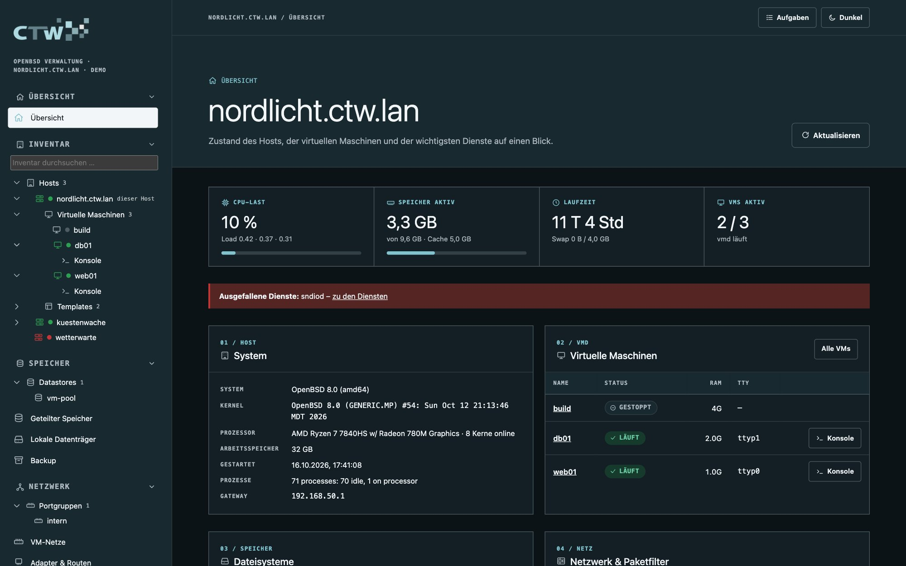
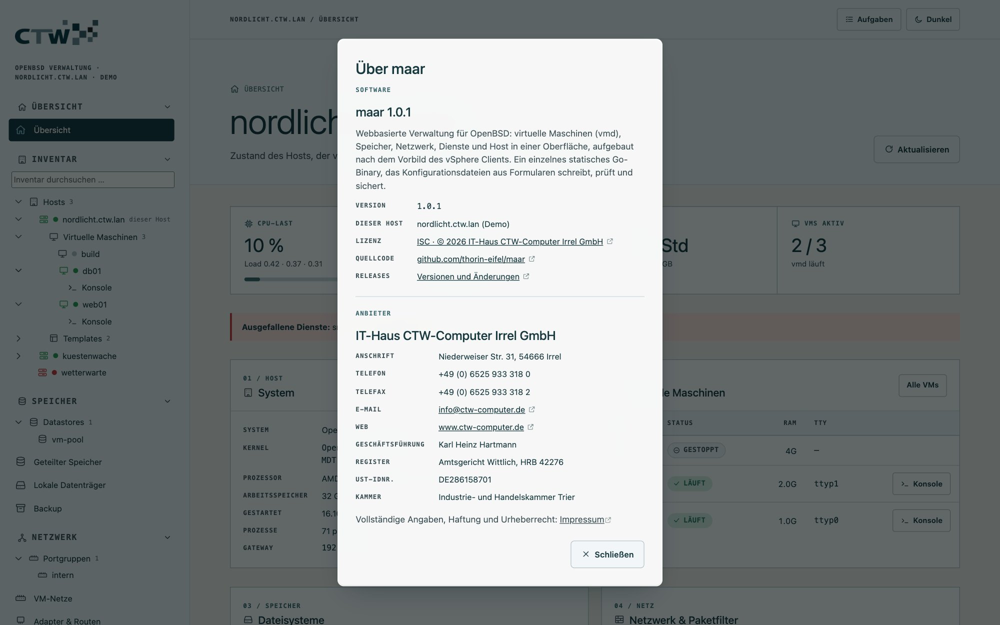

# 1 · Erste Schritte

[← Dokumentation](README.md) · [Weiter: Grundlagen für Einsteiger →](02-grundlagen.md)

## Voraussetzungen

- Ein Rechner mit **OpenBSD 8.0** (amd64 oder arm64). Für VMs braucht er Virtualisierungsunterstützung
  (Intel VT-x/EPT oder AMD-V/RVI); in einer VM gilt das nur bei verschachtelter Virtualisierung.
- Root-Zugang (Konsole oder SSH).
- Ein Benutzerkonto in der Gruppe `wheel` – damit meldest du dich später in der Oberfläche an.
- Ein Browser. maar braucht keine zusätzlichen Pakete auf dem Host.

## Installation

Als root auf dem OpenBSD-Host:

```sh
ftp -o - https://github.com/thorin-eifel/maar/releases/latest/download/install.sh | sh
```

Das Skript

1. erkennt die Architektur und lädt `maard` samt Prüfsummendatei aus dem GitHub-Release,
2. prüft die Datei mit `sha256 -C` und bricht bei Abweichung ab,
3. installiert `/usr/local/sbin/maard` und `/etc/rc.d/maard`, legt `/var/maar/backups` an,
4. aktiviert den Dienst (`rcctl enable maard`) und startet ihn.

Es endet mit der Adresse, unter der du dich anmelden kannst. Den **Startoptionen** (Adresse, Port,
Gruppe) widmet sich [die Referenz](10-referenz.md#startoptionen); schon bei der Installation setzt du sie so:

```sh
ftp -o - https://github.com/thorin-eifel/maar/releases/latest/download/install.sh \
  | MAAR_FLAGS="-listen 192.168.50.10:9443" sh
```

Eine bestimmte Version wählst du mit `MAAR_VERSION=1.0.1` (ebenfalls vor das `sh` am Ende der Pipe). **Aktualisieren** geht mit demselben Befehl:
Der Dienst wird kurz neu gestartet, deine Optionen und alle Daten unter `/var/maar` bleiben erhalten.

> **Tipp für Vorsichtige:** Lade `install.sh` zuerst herunter und lies sie – sie ist kurz.
> `ftp -o install.sh https://github.com/thorin-eifel/maar/releases/latest/download/install.sh`

### Ohne Skript installieren

Auf dem Mac oder Linux mit Go: `make release` baut beide Architekturen samt `SHA256` in `build/`. Dann
kopierst du `maard-openbsd-amd64` nach `/usr/local/sbin/maard` und `etc/rc.d/maard` nach
`/etc/rc.d/maard` und führst auf dem Host aus:

```sh
chmod 0555 /usr/local/sbin/maard /etc/rc.d/maard
install -d -m 0700 /var/maar/backups
rcctl enable maard
rcctl start maard
```

Direkt auf dem Host bauen geht mit `pkg_add go` und `make install` im Quellverzeichnis.

## Der erste Login

Öffne `https://<host>:9443`. Beim ersten Start erzeugt maar ein **selbst signiertes Zertifikat**
(`/etc/ssl/maar.crt`), deshalb warnt der Browser einmalig. Akzeptiere die Ausnahme oder hinterlege ein
eigenes Zertifikat ([TLS-Zertifikat](08-zugriff-und-sicherheit.md#tls-zertifikat)).

Angemeldet wird mit dem **Systemkonto** (BSD Auth): Benutzername und Passwort eines Kontos in der
Gruppe `wheel`. maar speichert keine eigenen Passwörter.

> Kommst du nicht hinein? Prüfe `rcctl check maard`, `tail /var/log/daemon` und ob der Port in
> `pf.conf` offen ist – siehe [Fehlersuche](09-betrieb.md#fehlersuche).

## Ausprobieren ohne OpenBSD

Wer erst schauen möchte: Auf jedem Mac oder Linux mit Go

```sh
make demo
```

startet einen **simulierten Host** auf `http://127.0.0.1:9443` (Anmeldung `demo` / `demo`). Alles in
dieser Dokumentation lässt sich dort nachvollziehen. Konfigurationsdateien liegen in einer temporären
Sandbox, die VM-Konsolen sind simuliert, und der Demo-Modus lauscht nur auf localhost.

## Die Oberfläche im Rundgang


**Menü links.** Es ist nach Aufgaben geordnet, wie im vSphere Client. Jede Gruppe lässt sich mit einem
Klick auf ihre Überschrift ein- und ausklappen; der Browser merkt sich das.

| Gruppe | Inhalt |
|---|---|
| **Übersicht** | Zustand des Hosts, der VMs und der Dienste auf einen Blick |
| **Inventar** | der Baum: Hosts → Host → Virtuelle Maschinen (mit „Konsole“ je laufender VM) und Templates |
| **Speicher** | Datastores (Baum), Geteilter Speicher (iSCSI/FC), Lokale Datenträger, Backup |
| **Netzwerk** | Portgruppen (Baum), VM-Netze, Adapter & Routen, Paketfilter |
| **Überwachung** | Leistung & Alarme, Ereignisse, Prozesse, Protokolle |
| **Host** | Host & Betrieb, System-Einstellungen, Pakete & Updates, Benutzer & Gruppen |
| **Dienste** | Systemdienste, Web/Mail/Lastverteilung |
| **Verwaltung** | Zugriffssteuerung, Konfigurationsdateien (nur Administratoren) |

**Inventarbaum.** Ein Klick auf eine VM öffnet ihre Detailseite, ein Klick auf „Konsole“ darunter die
serielle Konsole. Das Suchfeld oben filtert alle drei Bäume. Mit den Pfeiltasten bewegst du dich durch
den Baum, links/rechts klappt auf und zu. Auf schmalen Bildschirmen ersetzt eine flache Linkleiste den Baum.

**Kopfzeile.** Rechts oben: **Aufgaben** (Hintergrundjobs wie Pakete, Backups und Downloads mit Live-Ausgabe)
und der **Hell/Dunkel-Schalter**.



**Version und „Über maar“.** Unten links zeigt ein Klick auf die Versionsnummer die Angaben zur Software
und zum Anbieter.



## Was tut maar im Hintergrund?

- Es ruft die Standardwerkzeuge von OpenBSD auf (`vmctl`, `rcctl`, `pfctl`, `ifconfig`, `pkg_add` …) –
  immer mit Argumentlisten, **nie über eine Shell**.
- Konfigurationen entstehen aus **Formularen**. maar zeigt eine Vorschau, prüft die Syntax mit dem
  jeweiligen Werkzeug (z. B. `pfctl -nf`, `sshd -t`), legt eine Sicherung der alten Datei an und
  schreibt atomar. Zeilen und Kommentare, die das Formular nicht kennt, bleiben erhalten.
- Alle ändernden Aktionen stehen im **Ereignisprotokoll** und im Syslog.

Wie es weitergeht: Wenn du noch nie eine VM unter OpenBSD betrieben hast, lies
[Grundlagen für Einsteiger](02-grundlagen.md). Sonst geht es mit
[Virtuelle Maschinen](03-virtuelle-maschinen.md) weiter.
