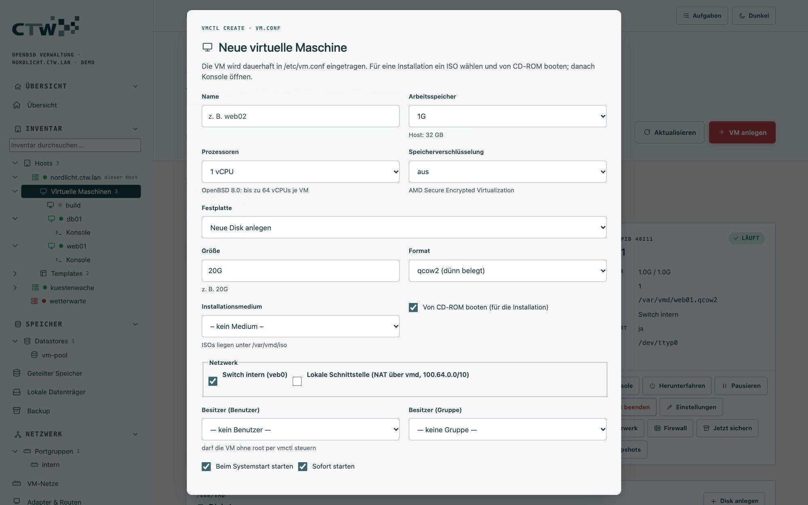

# 2 · Grundlagen für Einsteiger

[← Erste Schritte](01-erste-schritte.md) · [Dokumentation](README.md) · [Weiter: Virtuelle Maschinen →](03-virtuelle-maschinen.md)

Dieses Kapitel ist für alle, die Systemadministration lernen oder von anderen Plattformen (Windows,
Linux, VMware) zu OpenBSD kommen. Du musst nichts vorab wissen – wohl aber hilft es, die wenigen
Begriffe zu kennen, die maar voraussetzt.

## OpenBSD in zehn Minuten

OpenBSD ist ein Betriebssystem, das auf **Sicherheit und Einfachheit** ausgelegt ist. Für die
Verwaltung heißt das:

- **Alles Wesentliche steckt im Basissystem:** Virtualisierung (`vmd`), Firewall (`pf`), Webserver
  (`httpd`), Mailserver (`smtpd`), Zeitdienst (`ntpd`), SSH. Du installierst kaum Zusatzpakete.
- **Konfiguration liegt in Textdateien unter `/etc`.** Es gibt keine versteckte Datenbank. maar liest
  und schreibt genau diese Dateien – du kannst jederzeit nachsehen, was es getan hat.
- **Dienste starten mit `rcctl`.** `rcctl enable vmd` schaltet einen Dienst für den Systemstart ein,
  `rcctl start vmd` startet ihn jetzt.
- **Rechte** vergibt `doas` (die schlanke Alternative zu `sudo`) anhand von `/etc/doas.conf`.
- **Updates:** `syspatch` für Sicherheitskorrekturen am System, `pkg_add -u` für Pakete, `fw_update`
  für Firmware, `sysupgrade` für das nächste Release.
- **Der Standardnutzer ist root**, aber im Alltag arbeitest du als Mitglied der Gruppe `wheel` und
  erhöhst Rechte gezielt mit `doas`.

## Wie maar dazu passt

| Du kennst … | In maar heißt das … |
|---|---|
| vSphere-Client mit Inventarbaum | linker Baum: Hosts → VMs; dieselbe Menülogik |
| ESXi-Host | ein OpenBSD-Host mit `vmd` und `maard` |
| Datastore (VMFS/NFS) | **Datastore** – ein Verzeichnis unter `/var/vmd/<name>`, auf Wunsch auf SAN-Speicher |
| Portgruppe / vSwitch | **Portgruppe** auf einem `veb`-Switch, optional mit VLAN, DHCP, DNS, NAT |
| Template / Klonen | **Template** (schreibgeschütztes Basisimage) und verknüpfte Klone |
| Snapshot | **Snapshot** als qcow2-Kette (nur bei gestoppter VM) |
| vCenter | **Mehrere Hosts**: eine Zentrale liest mehrere `maard` lesend ab (kein Cluster, keine Migration) |

## Glossar

| Begriff | Bedeutung |
|---|---|
| **vmd** | der Virtualisierungsdienst von OpenBSD; startet und überwacht die VMs |
| **vmctl** | Kommandozeilenwerkzeug zu `vmd` (maar ruft es für dich auf) |
| **vm.conf** | Konfigurationsdatei der VMs unter `/etc/vm.conf` |
| **qcow2 / raw** | Formate für Disk-Images; qcow2 kann Overlays (Klone, Snapshots) |
| **veb / vport** | virtueller Switch und sein Anschluss auf dem Host (Gateway-Adresse) |
| **VLAN** | getrenntes Netz auf demselben Kabel, gekennzeichnet durch eine Nummer |
| **pf** | die Paketfilter-Firewall von OpenBSD, konfiguriert in `/etc/pf.conf` |
| **Anker (anchor)** | ein Bereich in pf, den ein Programm (hier maar) selbst verwaltet |
| **hostname.if** | Datei `/etc/hostname.em0` o. Ä., die ein Netzwerk-Interface dauerhaft einrichtet |
| **rc.d / rcctl** | Dienstverwaltung: Skripte unter `/etc/rc.d`, gesteuert mit `rcctl` |
| **doas** | rechteerhöhender Befehl, konfiguriert in `/etc/doas.conf` |
| **BSD Auth** | OpenBSDs Anmeldesystem; maar prüft dein Passwort darüber |
| **pledge** | Sicherheitsmechanismus: ein Programm beschränkt sich selbst auf die nötigen Systemaufrufe |
| **cloud-init** | Verfahren, mit dem Linux-Gäste beim ersten Start Hostname, Benutzer und Netz erhalten |
| **iSCSI / FC** | Netzwerkprotokolle, die Festplatten eines Speichersystems (SAN) an den Host reichen |
| **WWPN / IQN** | Namen von Fibre-Channel-Adaptern bzw. iSCSI-Zielen |

## Wichtige Verzeichnisse

| Pfad | Inhalt |
|---|---|
| `/etc/vm.conf` | VM-Definitionen und Switches |
| `/var/vmd/` | Disk-Images; ISOs in `/var/vmd/iso`, Templates in `/var/vmd/templates` |
| `/var/maar/` | Daten von maar: Rollen, Token, Netz-Absicht, Backup-Jobs, Messwerte, Sicherungen der Konfiguration |
| `/etc/ssl/maar.crt`, `/etc/ssl/private/maar.key` | TLS-Zertifikat von maar |
| `/var/log/` | Protokolle (in maar: Überwachung → Protokolle) |

## Die erste VM, Schritt für Schritt

Ziel: eine OpenBSD-Test-VM aus einer ISO-Datei.

### 1 · vmd einschalten

VMs brauchen den Dienst `vmd`. Auf einem frischen Host als root:

```sh
rcctl enable vmd
rcctl start vmd
```

Unter **Dienste → Systemdienste** siehst du, dass `vmd` läuft; dort kannst du Dienste auch ein- und
ausschalten. Die Übersicht meldet „vmd läuft“.


### 2 · Eine ISO bereitstellen

Öffne **Inventar → Virtuelle Maschinen**. Unter „Installationsmedien“ lädst du die ISO per URL herunter
(**ISO herunterladen**, z. B. `install80.iso` von einem OpenBSD-Mirror) oder lädst eine Datei hoch
(**ISO hochladen**). Der Download läuft als Aufgabe im Hintergrund, du siehst ihn oben rechts.


### 3 · VM anlegen

Klicke **VM anlegen**. Der Dialog bietet nur Werte an, die es gibt:

- **Name** (Buchstaben, Ziffern, `-`, `_`)
- **Arbeitsspeicher** (Vorgaben bis zum Hostspeicher) und **Prozessoren** (1 bis 64 vCPUs)
- **Speicherverschlüsselung** (SEV, nur auf AMD-Hosts anwählbar)
- **Festplatte**: *Neue Disk anlegen* (Größe, Format qcow2 dünn belegt oder raw) oder ein vorhandenes freies Image
- **Installationsmedium**: die ISO aus `/var/vmd/iso`, dazu **Von CD-ROM booten (für die Installation)**
- **Netzwerk**: ein Switch (z. B. `intern (veb0)`) und/oder die **lokale Schnittstelle** (NAT über vmd)
- **Besitzer** (Benutzer und Gruppe, dürfen die VM ohne root per `vmctl` steuern)
- **Beim Systemstart starten** und **Sofort starten**



### 4 · Von der ISO starten und installieren

Mit **Von CD-ROM booten** und **Sofort starten** startet die VM direkt in den Installer (später
geht das auch mit **Von ISO starten** an der VM). Dann öffnest du die **Konsole** – dort läuft der OpenBSD-Installer wie auf einem echten Rechner (Anleitung: [OpenBSD-FAQ, Installation](https://www.openbsd.org/faq/faq4.html)).
Der Installer fragt, ob die Standardkonsole auf `com0` gesetzt werden soll (Geschwindigkeit 115200) – bestätige beides mit Enter, denn die serielle Konsole ist der Zugang, den maar im Browser anzeigt.


### 5 · Nach der Installation

Fahre die VM herunter und starte sie normal („Starten“). Entferne bei Bedarf die ISO unter
**Konfigurieren → Bearbeiten → CD-ROM**. Setze **Autostart**, wenn die VM beim Hoststart mitlaufen soll.

Weiter: [VM-Detailseite und Bedienung](03-virtuelle-maschinen.md), [eigenes Netz für VMs](04-netzwerk-und-firewall.md),
[regelmäßige Sicherung](05-speicher-und-backup.md#backup).

## Sicher arbeiten – die wichtigsten Regeln

1. **Nie ohne Rückfahrkarte an Firewall oder Netzwerk.** maar wendet pf-Regeln und Interface-Änderungen
   *auf Probe* an: 60 Sekunden zum Bestätigen, sonst wird automatisch zurückgesetzt. Nutze das, statt
   direkt zu speichern.
2. **Vorschau lesen.** Jedes Formular zeigt die Datei, die entstehen würde. Wer wissen will, was maar
   tut, liest sie.
3. **Ein Konto, ein Zweck.** Lege für Kollegen Rollen an ([Rollen](08-zugriff-und-sicherheit.md#rollen-und-vm-eingrenzung)),
   statt das wheel-Passwort weiterzugeben.
4. **Backups testen.** Eine Sicherung zählt erst, wenn du einmal eine VM daraus wiederhergestellt hast.
5. **Updates einspielen.** `syspatch` regelmäßig; unter **Host → Pakete & Updates** geht das per Klick.
6. **Zugriff beschränken.** Die Oberfläche gehört ins Verwaltungsnetz, nicht ins Internet
   ([pf-Beispiel](10-referenz.md#pf-zugang-zur-oberfläche-beschränken)).

## Weiterlernen

- [OpenBSD-FAQ](https://www.openbsd.org/faq/) – die offizielle, hervorragende Anleitung
- Handbuchseiten: `man vmd`, `man vm.conf`, `man vmctl`, `man pf.conf`, `man doas.conf`, `man rcctl`
  – jede Funktion in maar verweist auf ein Werkzeug, dessen Manpage du so findest
- [Referenz: Menü und Befehle im Vergleich](10-referenz.md#menü-und-befehle-im-vergleich)
