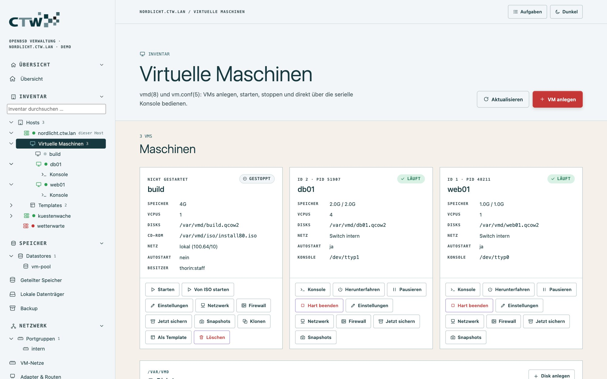
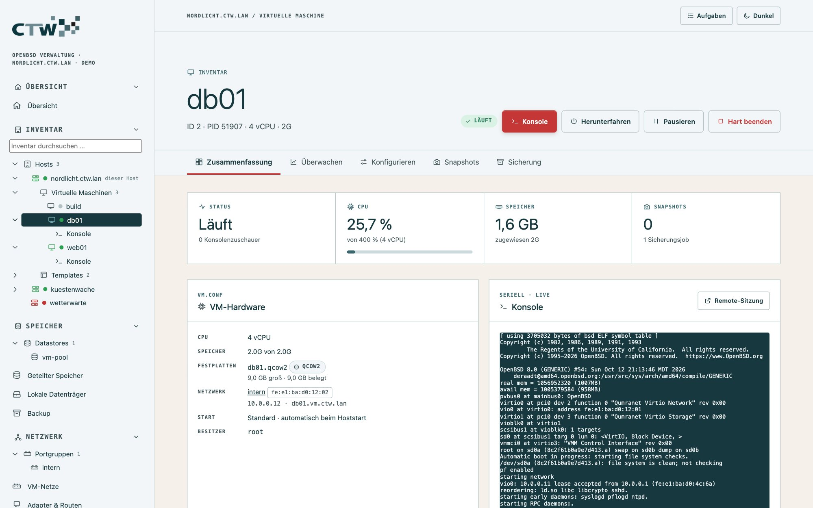
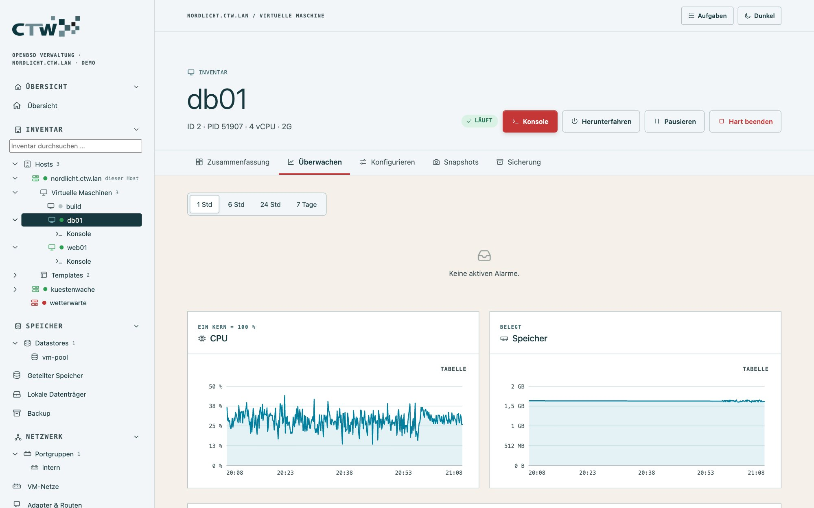
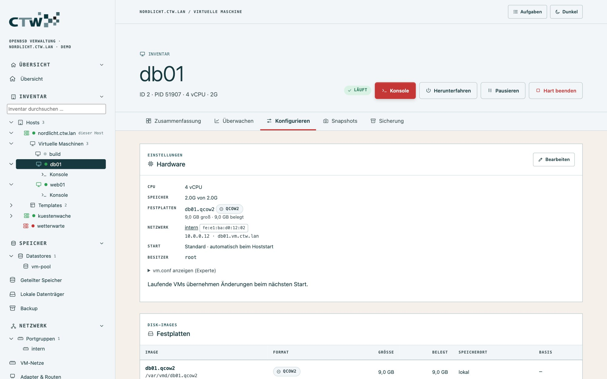
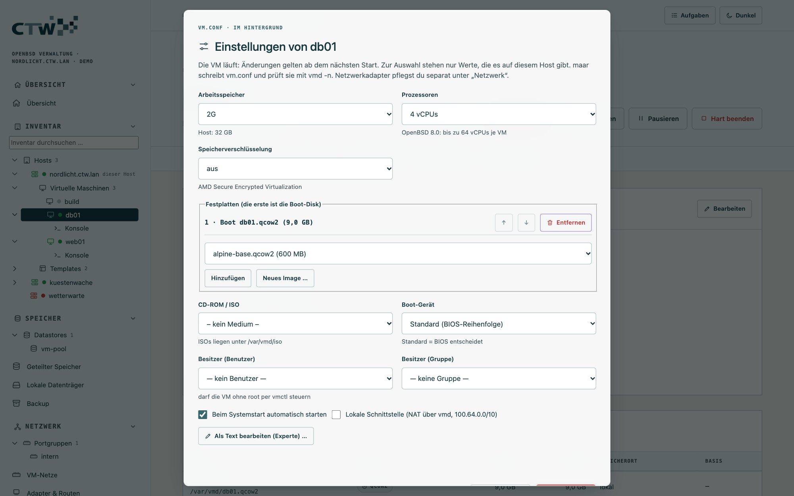
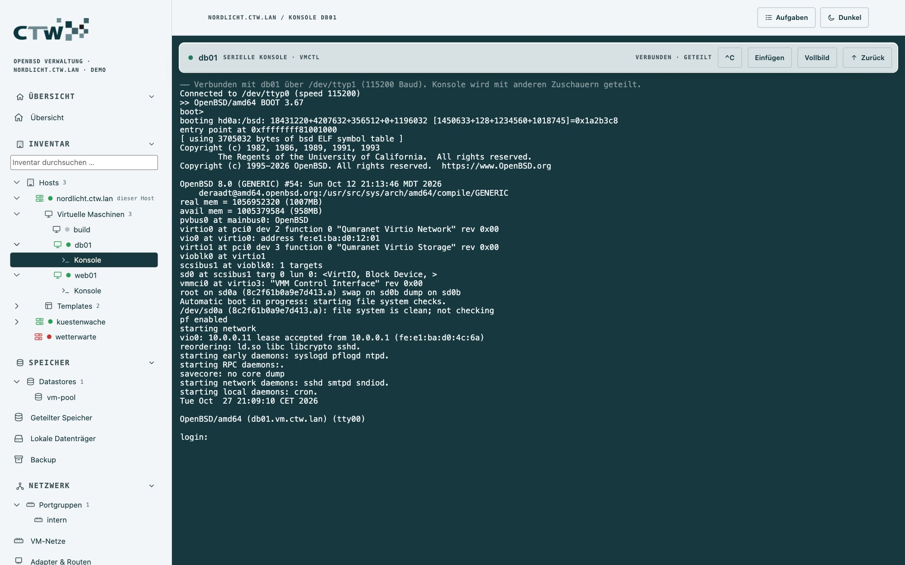
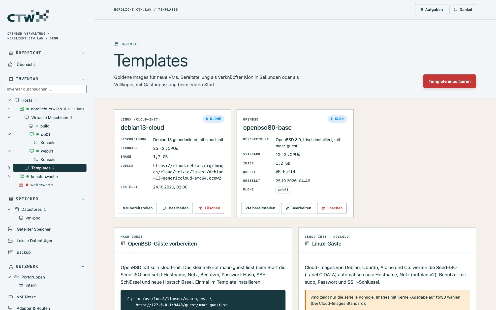
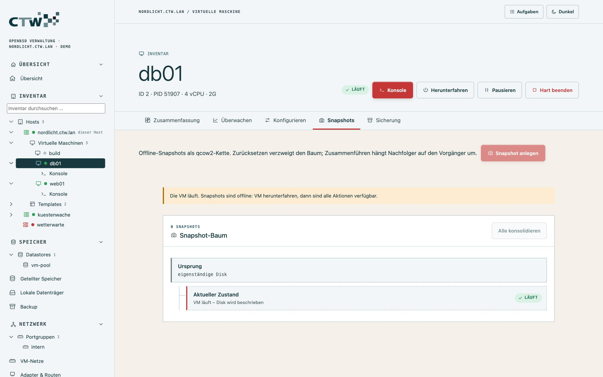

# 3 · Virtuelle Maschinen

[← Grundlagen](02-grundlagen.md) · [Dokumentation](README.md) · [Weiter: Netzwerk und Firewall →](04-netzwerk-und-firewall.md)

## Die VM-Liste

**Inventar → Virtuelle Maschinen** zeigt alle VMs als Karten mit Status, Speicher, vCPUs, Disks, Netz,
Autostart und Besitzer. Darunter stehen **Disk-Images**, **Installationsmedien** (ISOs) und die **Switches**.

Aktionen je VM: **Starten**, **Von ISO starten**, **Herunterfahren**, **Pausieren**, **Hart beenden**,
**Einstellungen**, **Netzwerk**, **Firewall**, **Jetzt sichern**, **Snapshots**, **Klonen**,
**Als Template** und **Löschen**. Gefährliche Aktionen (Löschen, Hart beenden) verlangen, dass du ein
Bestätigungswort abtippst.

## Die Detailseite

Ein Klick auf eine VM (in der Liste oder im Baum) öffnet ihre Detailseite. Sie ist wie im vSphere Client
in Reiter gegliedert; die Reiter sind verlinkbar (`#/vm/<name>/<reiter>`).

### Zusammenfassung

Status, CPU, Speicher und Snapshots als Kacheln, dazu **VM-Hardware**, **Netzwerk & Firewall**, **Sicherung**
und die **letzten Ereignisse** dieser VM. Rechts steht eine kleine **Live-Vorschau der Konsole** (4:3,
nur lesend). Ein Klick darauf oder auf **Remote-Sitzung** öffnet die volle, bedienbare Konsole in einem
neuen Browsertab. Die Vorschau erscheint nur bei laufenden VMs und nicht für Betrachter.

### Überwachen

CPU-, Speicher- und Netzverlauf der VM (1, 6, 24 Stunden oder 7 Tage), aktive Alarme und Ereignisse.
Jedes Diagramm hat einen Tooltip beim Überfahren und eine Tabellenansicht für Screenreader.

### Konfigurieren

Die Hardware der VM (aus `vm.conf`): Festplatten mit Format, Größe, Datastore und Basis-Template,
Netzwerkadapter mit MAC und Adresse, Firewall-Regeln. Hier änderst du die VM mit **Bearbeiten** (an der VM-Karte heißt der Knopf **Einstellungen**).

| Einstellung | Auswahl |
|---|---|
| Arbeitsspeicher | Vorgaben bis zum Hostspeicher, der aktuelle Wert, „Andere …“ |
| vCPUs | 1 bis 64; Werte über der Kernzahl des Hosts sind markiert |
| SEV / SEV-ES | nur auf AMD-Hosts wählbar |
| Festplatten | nur freie Images (auch aus Datastores), Reihenfolge per Pfeil, „Neues Image …“ legt es sofort an |
| CD-ROM | vorhandene ISOs; Boot von CD-ROM erst mit Medium wählbar |
| Boot-Gerät | Standard, Festplatte, CD-ROM, Netzwerk |
| Besitzer | Benutzer und Gruppe der Hostkonten |
| Start / lokale Schnittstelle | Schalter |

maar schreibt daraus den VM-Block in `/etc/vm.conf`, prüft ihn mit `vmd -n`, sichert die alte Datei und
lädt die Konfiguration. Alles, was das Formular nicht kennt (`boot <Kernel>`, `allow instance` …),
bleibt unverändert. Der Server wiederholt die Prüfungen: Disks anderer VMs, Pfade außerhalb von
`/var/vmd` und unbekannte Konten werden abgelehnt. **vm.conf anzeigen** zeigt den Block als Text.

Die VM-Änderungen wirken nach dem **nächsten Start** der VM, sofern sie laufende Hardware betreffen.

### Snapshots und Sicherung

Siehe [Snapshots](#snapshots) und [Backup](05-speicher-und-backup.md#backup).

## Konsole

Die **serielle Konsole** entspricht `vmctl console`. Öffne sie über **Konsole** an der VM, im Baum unter der VM
oder aus der Vorschau.

- Die Konsole ist **geteilt**: Mehrere Administratoren sehen dieselbe Sitzung; neue Zuschauer erhalten
  die letzten 64 KB Verlauf.
- **^C** sendet Strg+C, **Einfügen** übernimmt die Zwischenablage, **Vollbild** nutzt den ganzen Bildschirm.
- Bricht die Verbindung ab, bietet die Leiste **Neu verbinden** an.
- Die VM-Seite zeigt als „Konsolenzuschauer“ die Zahl der verbundenen Zuschauer. Die Live-Vorschau
  zählt dabei nicht mit und schreibt keinen Ereigniseintrag.

Unter **Host → Host & Betrieb → Host-Shell** (nur Administratoren) gibt es zusätzlich eine Login-Shell
auf dem Host als dein Benutzer (`su -l`), nicht als root; für Root-Rechte `doas` verwenden.

## Templates und Klone

Ein **Template** ist ein schreibgeschütztes Basisimage mit Beschreibung unter `<vmdir>/templates`.
Daraus legst du in Sekunden neue VMs an:

1. **Template erzeugen:** *Template importieren* (per URL, z. B. ein Debian-Cloud-Image, oder aus einem
   vorhandenen Image) oder an einer gestoppten VM **Als Template** wählen.
2. **Bereitstellen:** Template wählen, Name, Speicher und Netz festlegen. Als **verknüpfter Klon**
   (qcow2-Overlay, spart Platz und Zeit) oder als **Vollkopie** (unabhängig).
3. maar legt die Disk an (`vmctl create -b` bzw. `-i`), erzeugt bei Bedarf die Seed-ISO, trägt die VM
   in `vm.conf` ein und startet sie.

Welche VMs auf einem Template aufbauen, liest maar aus dem qcow2-Header. Ein Template lässt sich nicht
löschen, solange Klone darauf basieren. Eine **laufende VM lässt sich nicht klonen**, und VM-Klone sind
immer Vollkopien – ein Overlay auf eine Disk, die weiter beschrieben wird, würde beschädigt.

### Gastanpassung

Beim Bereitstellen kannst du Hostname, DHCP oder feste IP, Gateway, DNS, Benutzer, Passwort und
SSH-Schlüssel vorgeben; neue SSH-Hostschlüssel entstehen beim ersten Start.

| Gast | Verfahren |
|---|---|
| **Linux** (Cloud-Images) | cloud-init NoCloud: maar erzeugt eine Seed-ISO (Label `CIDATA`) mit `meta-data`, `user-data` und `network-config` |
| **OpenBSD** | einmalig im Template das Skript [`maar-guest`](../web/guest/maar-guest.sh) installieren (die Templates-Seite zeigt die Befehle); es wertet die Seed-ISO nur bei neuer Instanz-ID aus |

Das Passwort wird nur als bcrypt-Hash übergeben.

## Snapshots

Snapshots liegen an der einzelnen VM (**Reiter Snapshots**). Sie sind **Offline-Snapshots** – die VM
muss gestoppt sein, vmd kennt keine Live-Snapshots. Beim Anlegen wandert die aktive Disk in den
Snapshot und wird durch ein leeres Overlay ersetzt; der Pfad in `vm.conf` bleibt gleich und die Dauer
hängt nicht von der Diskgröße ab.

| Aktion | Wirkung |
|---|---|
| **Snapshot anlegen** | friert alle Disks der VM ein |
| **Zurücksetzen** | verwirft den aktuellen Zustand und geht zum Snapshot zurück (optional vorher sichern) |
| **Umbenennen** | ändert den Namen |
| **Löschen** | nur für Blätter ohne Nachfolger |
| **Zusammenführen** | führt einen Snapshot mit Nachfolgern zusammen – braucht das Paket `qemu` (`qemu-img rebase`) |
| **Alles konsolidieren** | macht die Disk wieder eigenständig; ohne `qemu-img` als Vollkopie, mit `qemu-img` bleibt die Template-Basis |

Die Baumansicht mit Verzweigungen liest maar aus den qcow2-Headern, nicht aus einer eigenen Datenbank.

> **Snapshots sind kein Backup.** Sie liegen auf demselben Speicher wie die VM. Für Datensicherung
> siehe [Backup](05-speicher-und-backup.md#backup).

## VM löschen

**Löschen** entfernt den VM-Block aus `vm.conf`. Die
Bestätigung verlangt den VM-Namen. Disks, auf denen Klone aufbauen, bleiben geschützt.

## Häufige Fragen

**Die VM startet nicht.** Prüfe in der Detailseite unter „Letzte Ereignisse“ den Fehler und unter
**Überwachung → Protokolle** `daemon` und `messages`. Häufige Ursachen: `vmd` läuft nicht
([Dienste](06-host-und-dienste.md#dienste)), das Disk-Image liegt außerhalb von `/var/vmd`, zu wenig Speicher.

**Die VM bekommt keine Adresse.** Sie hängt im „lokalen Netz“ ohne DHCP oder an einer Portgruppe ohne
DHCP-Bereich – siehe [Portgruppen](04-netzwerk-und-firewall.md#portgruppen-anlegen).

**Kann ich eine laufende VM verschieben?** Nein – vmd bietet weder Live-Migration noch Live-Snapshots.
