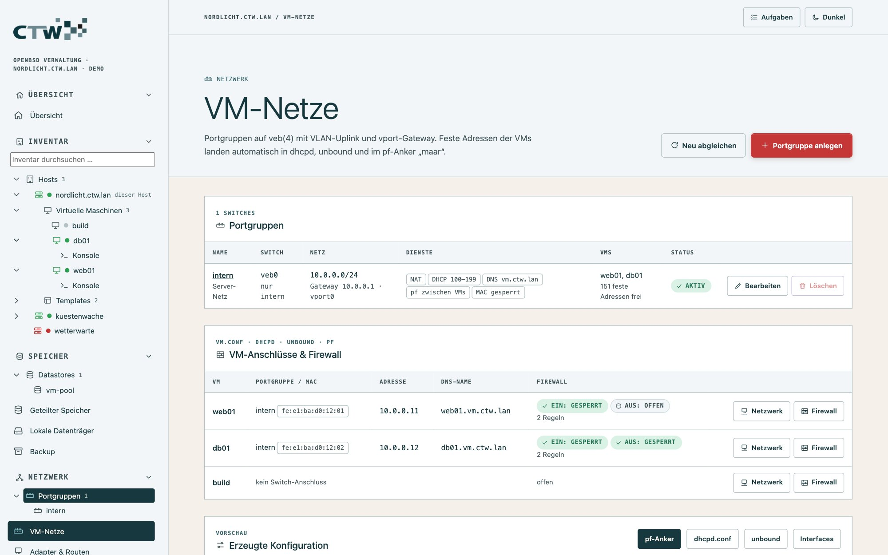
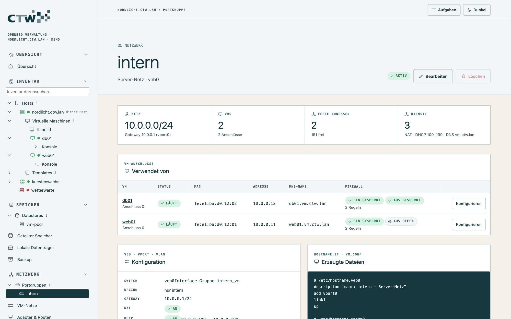
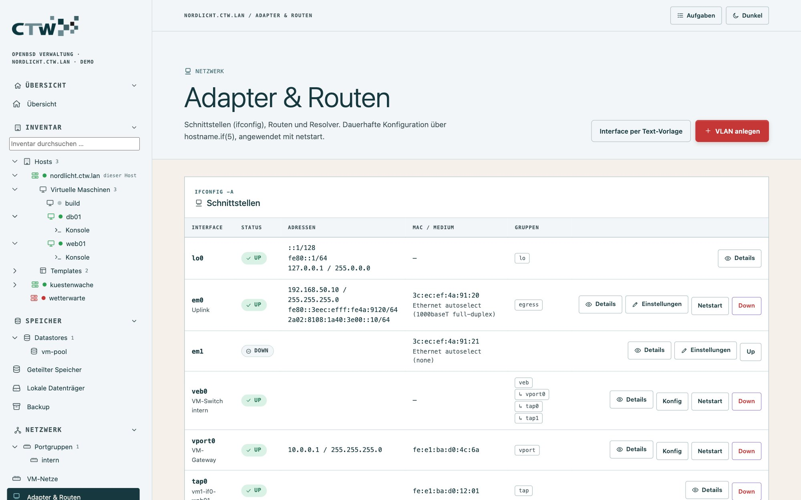
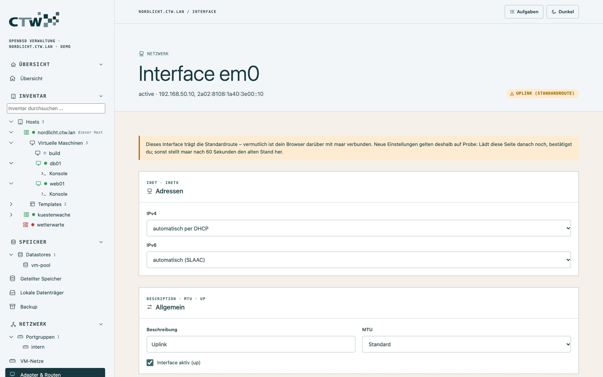
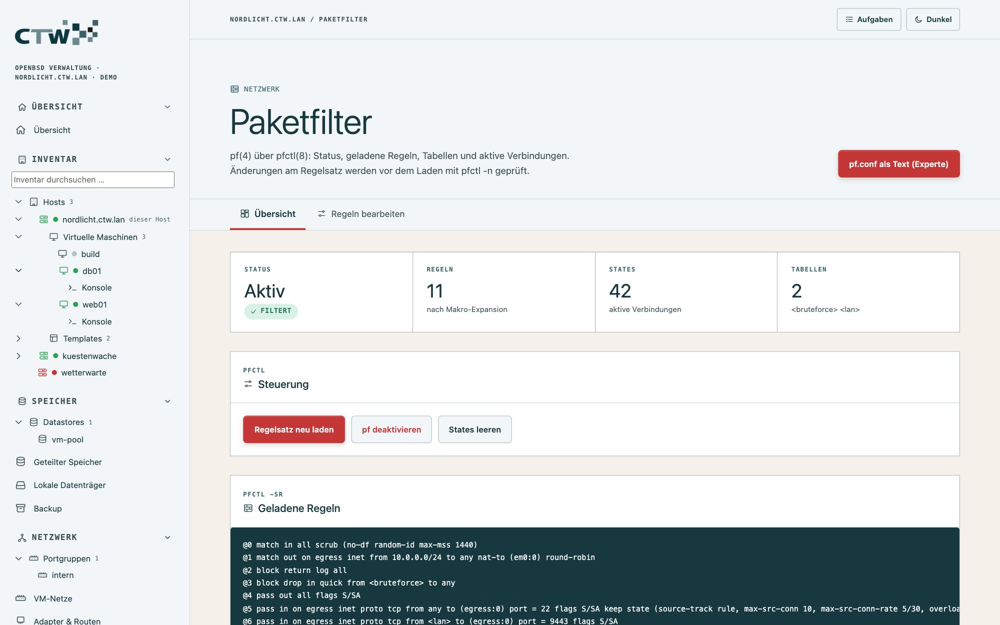
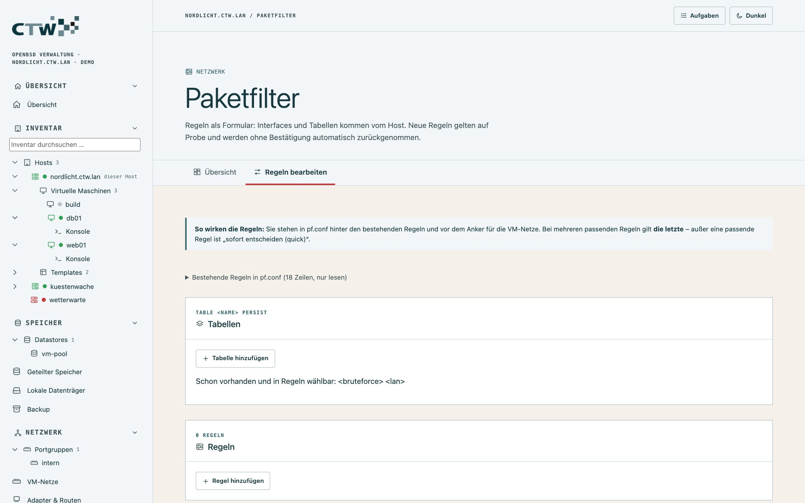

# 4 · Netzwerk und Firewall

[← Virtuelle Maschinen](03-virtuelle-maschinen.md) · [Dokumentation](README.md) · [Weiter: Speicher und Backup →](05-speicher-und-backup.md)

## Das Konzept: Portgruppen

VMs hängen an **Portgruppen**, wie im vSphere Client. Eine Portgruppe ist ein virtueller Switch (`veb`) mit
optionalen Eigenschaften:

- **Uplink:** ein physisches Interface (oder ein VLAN darauf), damit die VMs ins echte Netz kommen
- **Gateway:** eine Adresse des Hosts im VM-Netz (`vport`), die zugleich Router für die VMs ist
- **NAT:** VMs erreichen das Internet über die Adresse des Hosts
- **DHCP-Bereich** und **DNS-Domain:** der Host vergibt Adressen und löst die VM-Namen auf
- **Firewall zwischen VMs** (`link1`) und **`locked lladdr`**: VMs können weder untereinander noch mit
  gefälschten MAC-Adressen beliebig Verkehr erzeugen

maar speichert nur die **Absicht** in `/var/maar/network.json` und erzeugt daraus alle Dateien – mit
Prüfung und Sicherung. Du bearbeitest also nie `hostname.veb0`, `dhcpd.conf`, `unbound` oder `pf` von Hand.

| Erzeugt | Inhalt |
|---|---|
| `/etc/hostname.vebN`, `.vportN`, `.vlanN` | Switch mit Mitgliedern, Gateway-Adresse, VLAN auf dem Uplink |
| `/etc/vm.conf` | `switch`-Blöcke mit `locked lladdr`, Anschlüsse der VMs mit fester MAC |
| `/etc/dhcpd.conf` | eigener Bereich zwischen `# >>> maar` und `# <<< maar`, automatische Reservierungen |
| `/var/unbound/etc/maar.conf` | Zonen sowie A- und PTR-Einträge der VMs |
| `/etc/pf.maar.conf` | Anker `maar`: NAT, DHCP/DNS zum Gateway, Regeln je VM |

## Portgruppen anlegen

**Netzwerk → VM-Netze → Portgruppe anlegen.**



1. **Name** vergeben (z. B. `intern`).
2. **Uplink** wählen: kein Uplink (reines Hostnetz), ein physisches Interface oder ein VLAN darauf.
   Ein Uplink ohne VLAN-Tag darf keine eigene IP haben, sonst weist maar ihn ab.
3. **Gateway** setzen (z. B. `10.0.0.1/24`) – das macht den Host zum Router dieses Netzes.
4. **NAT** an, wenn die VMs über den Host ins Internet sollen.
5. **DHCP-Bereich** und **DNS-Domain** festlegen (z. B. `vm.example.lan`).
6. Speichern: maar schreibt die Dateien, prüft sie und lädt die Dienste neu. Was entstanden ist, zeigt das
   Panel **Erzeugte Konfiguration** unten auf der Seite (Reiter *pf-Anker*, *dhcpd.conf*, *unbound*,
   *Interfaces*). **Neu abgleichen** erzeugt alles aus der gespeicherten Absicht erneut.

Bestehende Switches aus `vm.conf` erscheinen als „vorgefunden“; erst beim Speichern schreibt maar ihre
Dateien. Deklariert `dhcpd.conf` ein Subnetz schon außerhalb des maar-Bereichs, bricht der Abgleich mit
einem Hinweis ab, statt Konflikte zu erzeugen.

### Die Portgruppen-Seite

Ein Klick auf die Portgruppe im Baum (unter Netzwerk) öffnet ihre Seite:



- **Verwendet von:** alle VM-Anschlüsse mit Status, MAC, Adresse, DNS-Name und Firewall
- **Konfiguration:** Uplink, VLAN, Gateway, NAT, DHCP, DNS
- **Erzeugte Dateien:** was maar daraus geschrieben hat

Konten, die auf bestimmte VMs eingegrenzt sind, sehen dort nur ihre VMs und die Zahl der ausgeblendeten.

## VMs anschließen

An der VM (oder im Panel **VM-Anschlüsse & Firewall** der VM-Netze): **Netzwerk**. Pro Anschluss wählst du die Portgruppe, eine **feste
MAC** und die **Adresse** – fest oder dynamisch. Feste Adressen erzeugen automatisch eine
**DHCP-Reservierung** und **DNS-Einträge** (A und PTR); die VM erreichst du dann unter `name.<domain>`.

## Firewall je VM

An der VM (oder im Panel **VM-Anschlüsse & Firewall**): **Firewall**. Eine Grundregel (eingehend/ausgehend offen oder gesperrt) plus Regeln mit
Aktion, Richtung, Protokoll, Port und Gegenstelle. Als Gegenstelle gehen ein Netz, eine pf-`<tabelle>`
oder eine andere VM. maar erzeugt daraus Regeln im Anker `maar` – ohne dass du `pf.conf` anfasst.

> **Hinweis:** Eine VM-Firewall kann nur Verkehr filtern, der den Host passiert. Zwischen VMs
> derselben Portgruppe gilt sie nur, wenn die Portgruppe die Firewall zwischen VMs (`link1`) einschaltet.

## Schnittstellen und Routen

**Netzwerk → Adapter & Routen** zeigt alle Interfaces mit Adressen, `veb`-Mitgliedern und Status, die
Routingtabelle und den Resolver.



Ein Klick auf ein Interface (**Einstellungen**) öffnet das Formular für `/etc/hostname.<if>`:



| Einstellung | Auswahl |
|---|---|
| IPv4 | DHCP, fest (Hauptadresse mit Netzwahl, weitere Adressen als Alias, Standard-Gateway in `/etc/mygate`) oder keine |
| IPv6 | automatisch (SLAAC), fest oder keine |
| Beschreibung, MTU | Standard, 1280, 1492, 1500, Jumbo 9000 |
| Aktiv | Interface hoch/runter |
| VLAN | physisches Interface und ID (auch über **VLAN anlegen**) |

Zeilen, die das Formular nicht kennt (`lladdr`, `media`, `!befehl` …), bleiben unverändert. Interfaces,
die die VM-Netze erzeugen (`veb`, `vport`, `vlan` der Portgruppen), sind hier gesperrt und verweisen auf
die VM-Netze.

### Änderungen auf Probe

Netzwerkänderungen sind der klassische Weg, sich selbst auszusperren. Deshalb wendet maar sie **auf Probe** an:

1. Du klickst **Auf Probe anwenden**. maar sichert den alten Zustand und führt `netstart` aus.
2. Du hast **60 Sekunden**, die Änderung zu bestätigen. Lädt die Seite noch und antwortet, bist du durchgekommen.
3. **Bestätigen** macht sie dauerhaft. Bleibt die Bestätigung aus, **stellt maar Datei, Gateway und
   Interface selbst wieder her** – auch nach einem Neustart von `maard` (bei einem neuen VLAN wird es wieder entfernt).

Geprüft werden vorab: keine Netz- oder Broadcast-Adresse, keine doppelte oder auf einem anderen
Interface vergebene Adresse, Gateway im eigenen Netz, MTU, Beschreibung, VLAN-Angaben. Für das
Uplink-Interface gibt es eine eigene Warnung.

## Paketfilter (pf)

**Netzwerk → Paketfilter** zeigt Status, geladene Regeln, Tabellen, aktive Verbindungen (States) und
Statistik; hier schaltest du pf ein und aus.



### Paketfilter-Regeln auf Probe

Reiter **Regeln bearbeiten**:



- **Tabellen:** Adresslisten (`table <name> persist`). Neue Tabellen dürfen keine vorhandene überdecken.
- **Regeln:** Aktion (pass/block), Richtung, **Interface** (aus `ifconfig`, plus `egress`), Protokoll,
  **Von/Nach** (beliebig, `self`, vorhandene Tabellen, Adresse oder Netz), **Zielports** (Dienstliste
  oder Zahlen, Bereiche), `quick`, `log` und die Reihenfolge. Unter jeder Regel steht sie als Klartext.
- maar verwaltet **einen eigenen Block** in `/etc/pf.conf`, vor dem Anker für die VM-Netze. Die
  bestehenden Regeln siehst du ausgeklappt, sie bleiben unberührt.
- **Merke:** In pf gilt von mehreren passenden Regeln die **letzte** – außer eine passende ist `quick`.

Neue Regeln gelten **auf Probe**: Nach dem Laden hast du 60 Sekunden zum Bestätigen. Antwortet die Seite
noch, ist das der Beweis, dass du durchkommst. Ohne Bestätigung stellt maar den alten Regelsatz wieder
her – auch wenn `maard` in der Zwischenzeit beendet wird (Wiederherstellung beim Start). Regeln, die die
Oberfläche oder SSH sperren könnten, bekommen eine Warnung.

## Firewall absichern: ein Beispiel

Ziel: Die Oberfläche nur aus dem Verwaltungsnetz `192.168.50.0/24` erreichbar machen. Als Formular:

1. Tabelle `admin` mit `192.168.50.0/24` anlegen.
2. Regel: **pass in** auf `egress`, Protokoll **tcp**, **Von** Tabelle `<admin>`, **Nach** `self`, **Zielport** `9443`.
3. **Auf Probe anwenden** und innerhalb von 60 Sekunden bestätigen.

Als Datei entspricht das:

```
table <admin> const { 192.168.50.0/24 }
pass in on egress proto tcp from <admin> to (egress) port 9443
```

Weiter: [Speicher und Backup](05-speicher-und-backup.md).
