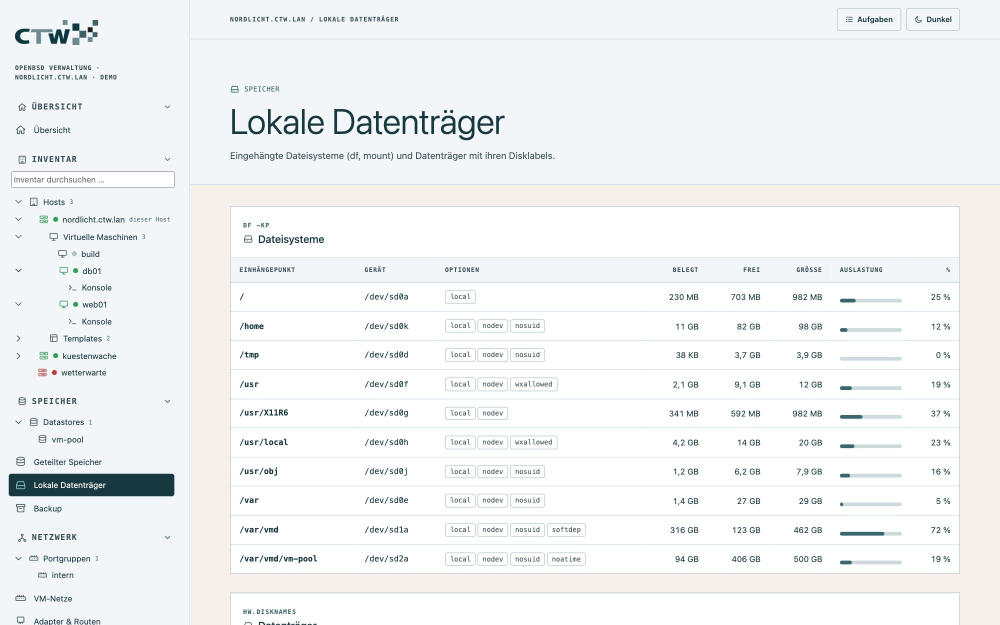
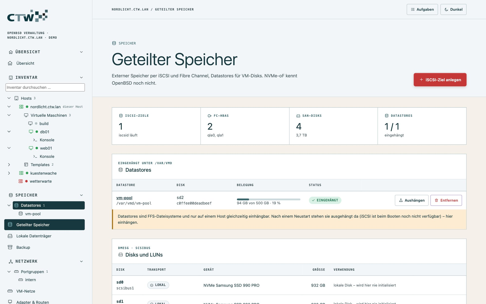
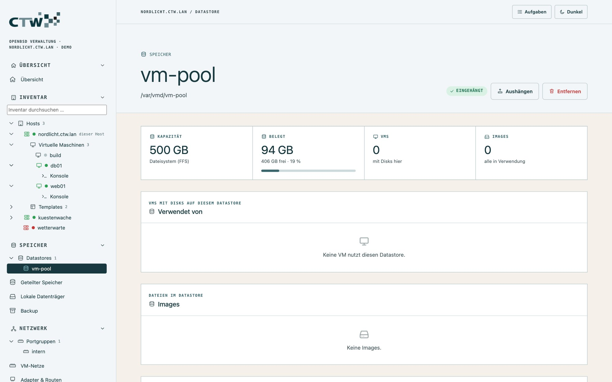
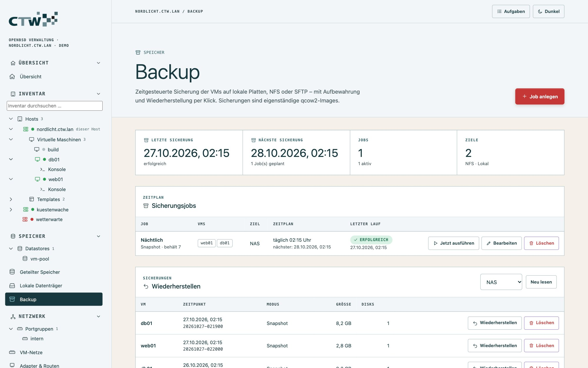

# 5 · Speicher und Backup

[← Netzwerk und Firewall](04-netzwerk-und-firewall.md) · [Dokumentation](README.md) · [Weiter: Host und Dienste →](06-host-und-dienste.md)

## Lokale Datenträger

**Speicher → Lokale Datenträger** zeigt Dateisysteme (Belegung) und Datenträger (Disklabels).

Partitionieren und Formatieren (`disklabel -E`, `newfs`) ist bewusst keine Ein-Klick-Aktion; dafür
gibt es die Host-Shell ([Konsole](03-virtuelle-maschinen.md#konsole)).

## Datastores

Ein **Datastore** ist ein Verzeichnis unter `/var/vmd/<name>`, auf dem VM-Disks liegen dürfen – typischerweise
eine eigene Platte oder eine SAN-LUN mit FFS-Dateisystem. Beim Anlegen eines Disk-Images wählst du den
Speicherort; vorhandene Images eines eingehängten Datastores erscheinen in der VM-Übersicht.

Der Baum unter **Speicher → Datastores** führt zur Detailseite eines Datastores:

- **Verwendet von:** welche VMs Disks darauf haben, mit Belegung
- **Images:** alle Disk-Images; unbenutzte sind markiert
- **Gerät:** Transport, WWN, DUID des Datenträgers dahinter

### Datastore anlegen (SAN-Disk)

**Speicher → Geteilter Speicher → Disks und LUNs:**

1. Eine **freie SAN-Disk** wählen. Angeboten werden nur Disks mit Transport iSCSI, FC oder Multipath.
2. **Disk löschen und anlegen:** maar initialisiert GPT, Label und FFS und hängt sie unter
   `/var/vmd/<name>` ein (fstab-Eintrag mit `noauto`, markiert mit `# maar datastore <name>`).
3. Die Bestätigung verlangt den **Gerätenamen** (z. B. `sd2`) – Schutz vor Verwechslung. Eine Disk mit
   vorhandenem Label wird gesondert gewarnt.

**Was maar nie initialisiert:** lokale Disks, die Systemdisk, eingehängte Disks und Disks in `/etc/fstab`.

Ein Datastore lässt sich **nicht aushängen**, solange VMs darauf laufen, und **nicht entfernen**, solange
VMs seine Images verwenden (beim Entfernen bleiben die Daten erhalten). Ein iSCSI-Ziel lässt sich nicht
löschen, solange ein Datastore auf einer seiner Disks eingehängt ist.

> **Grenzen:** FFS ist kein Cluster-Dateisystem. Ein Datastore darf immer nur auf **einem** Host
> eingehängt sein – bei mehreren Hosts braucht jeder eigene LUNs. Nach einem Neustart stehen Datastores
> **ausgehängt** da, weil iSCSI beim Booten noch fehlt; **Einhängen** holt das nach.

## iSCSI-Ziele einbinden

OpenBSD hat einen iSCSI-Initiator (`iscsid`, gesteuert mit `iscsictl`). maar verwaltet Ziele als eigenen
Block `# >>> maar` in `/etc/iscsi.conf`; von Hand eingetragene Ziele bleiben unangetastet.

1. **Geteilter Speicher → iSCSI → Ziel hinzufügen:** **Ziel-IQN** und **Adresse des Ziels** eintragen.
2. maar prüft die Syntax (`iscsid -nf`), aktiviert und startet `iscsid` und lädt mit `iscsictl reload`.
3. Die Sitzung erscheint mit Status; die LUNs tauchen als `sd`-Geräte unter **Disks und LUNs** auf.
4. Weiter mit „Datastore anlegen“.

**CHAP wird noch nicht gesetzt**, weil die Syntax in `iscsi.conf(5)` nicht belegt ist. Nutze bis dahin
Netz-Trennung oder Zugriffsregeln am Speichersystem.

## Fibre Channel

Unter OpenBSD bedienen die Treiber `qla`, `qlw` und `qle` die HBAs; die LUNs erscheinen als `sd`-Geräte.
maar zeigt die **HBAs mit WWPN** (für Zoning und LUN-Masking am Switch bzw. Speichersystem) und die LUNs
je HBA. Eine Konfiguration auf dem Host gibt es nicht – sie passiert am Speichersystem.

## NVMe over Fabrics

**Nicht vorhanden:** `nvme(4)` bedient unter OpenBSD nur lokale PCIe-Laufwerke. maar zeigt das offen als
Hinweis, statt etwas vorzutäuschen.

## Backup

Eine Sicherung ist eine **vollständige, eigenständige Kopie** der VM: `manifest.json` (mit dem
`vm.conf`-Block) und `diskN.qcow2` unter `<ziel>/<vm>/<JJJJMMTT-hhmmss>/`. Die Disks sind zusammengeführt
(`vmctl create -i`) – sie lassen sich ohne Template, Snapshots oder maar einsetzen.

### Ziel einrichten

**Speicher → Backup → Ziel anlegen:**

| Ziel | Hinweis |
|---|---|
| **Lokal** | am besten eine eigene Platte; Systemverzeichnisse und das VM-Verzeichnis sind gesperrt |
| **NFS** | wird pro Lauf unter `/var/maar/mnt/<ziel>` eingehängt |
| **SFTP** | maar erzeugt einen eigenen Schlüssel `/var/maar/backup_ed25519`; die Oberfläche zeigt den **öffentlichen** Teil – trage ihn beim SFTP-Server ein |

### Job anlegen

**Job anlegen:** VMs wählen, **Zeitplan** (stündlich, täglich, wöchentlich oder manuell), **Ziel**, **Modus**
und **Aufbewahrung** (Anzahl Sicherungen je VM). Die Zeitpläne laufen im Dienst; **verpasste Termine** (der
Dienst war aus) werden einmal nachgeholt. **Jetzt ausführen** am Job oder **Jetzt sichern** an der VM startet sofort eine Sicherung.

### Modus wählen

| Modus (laufende VM) | Ablauf | Ausfall |
|---|---|---|
| **Snapshot** (empfohlen) | herunterfahren → als Snapshot `maar-backup` einfrieren → starten → aus dem Snapshot sichern; der vorige Backup-Snapshot wird im selben Stopp zusammengeführt | Herunterfahren + Booten |
| **Offline** | herunterfahren → sichern → starten | gesamte Kopierdauer |
| **Pause** | pausieren → sichern → fortsetzen (absturzkonsistent) | VM steht während der Kopie |

Der Snapshot-Modus braucht `qemu-img` (`pkg_add qemu`) und qcow2-Disks; sonst sichert maar offline und
vermerkt das im Protokoll.

### Wiederherstellen

Im Panel **Wiederherstellen** wählst du oben das Ziel (**Neu lesen** aktualisiert die Liste) und klickst bei der gewünschten Sicherung auf **Wiederherstellen**:

- **Als neue VM:** erzeugt eine neue, **beim Systemstart deaktivierte** VM – standardmäßig **ohne Netz**, um
  IP-Konflikte mit dem Original zu vermeiden. Du aktivierst Netz und Autostart bewusst.
- **Über die bestehende VM:** die VM muss gestoppt sein; maar sichert vorher ihren aktuellen Zustand als
  **Sicherheits-Snapshot**.

> **Teste die Wiederherstellung** einmal in einer ruhigen Minute. Erst dann ist das Backup eines.

Konfiguration und Verlauf der Jobs stehen in `/var/maar/backup.json`. Fehlgeschlagene Sicherungen lösen
ein [Ereignis und eine Mail](07-ueberwachung.md#alarmregeln-und-mail) aus.

Weiter: [Host und Dienste](06-host-und-dienste.md).
