# 6 · Host und Dienste

[← Speicher und Backup](05-speicher-und-backup.md) · [Dokumentation](README.md) · [Weiter: Überwachung und Alarme →](07-ueberwachung.md)

## Host & Betrieb

**Host → Host & Betrieb** zeigt Kernel-Parameter (sysctl) und bietet **Neu starten**, **Ausschalten** und die
**Host-Shell**.

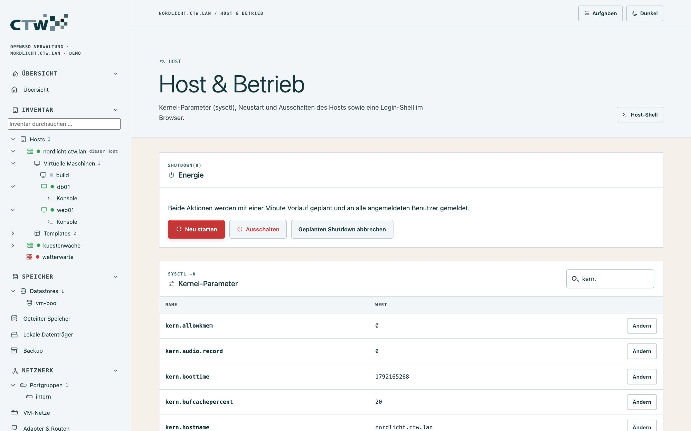

Neustart und Ausschalten laufen als `shutdown -r +1` bzw. `-p +1`: Du hast eine Minute zum Abbrechen.
Alle laufenden VMs werden beendet. Ein Einschalten über die Oberfläche ist natürlich nicht möglich.

## System-Einstellungen per Formular

**Host → System-Einstellungen** (nur Administratoren) ersetzt das Editieren von Konfigurationsdateien durch
Formulare, die nur anbieten, was es auf dem Host wirklich gibt. Das Prinzip ist überall gleich:

1. **Formular ausfüllen.** Auswahllisten kommen vom Host (Interfaces, Konten, Sensoren, Zertifikate …).
2. **Vorschau** der Datei ansehen, die entstehen würde.
3. **Speichern und anwenden:** maar prüft die Syntax mit dem passenden Werkzeug, **sichert die alte Fassung**
   und lädt den Dienst neu. Kommentare und Zeilen, die das Formular nicht kennt, bleiben erhalten.

### Zeit (ntpd)

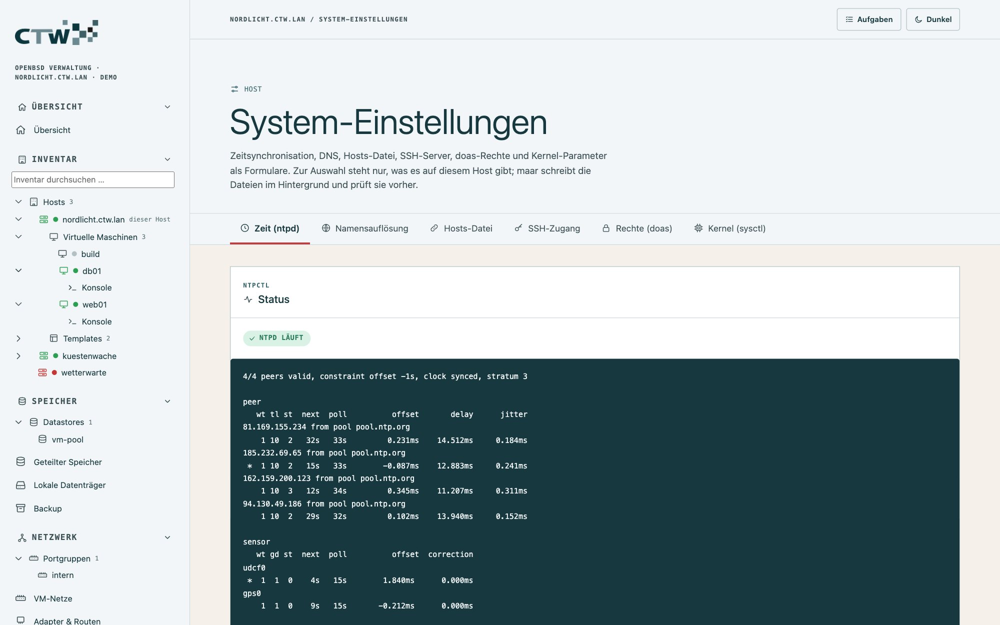

Server oder Pool (Gewicht 1–10, vertrauenswürdig), nur tatsächlich vorhandene **Zeit-Sensoren**
(`hw.sensors`, z. B. GPS), **Constraints** (HTTPS-Zeitprüfung), `listen on` mit den Adressen des Hosts.
Oben steht der Live-Status aus `ntpctl -s all`.

### Namensauflösung und Hosts-Datei

`/etc/resolv.conf`: bis zu 5 Nameserver (Vorschläge: laufender Resolver, Gateway, öffentliche Resolver),
Suchdomänen (max. 6), `lookup`-Reihenfolge, `family`, `edns0`, `tcp`, `trust-ad`, `ndots`. Maar warnt,
wenn `resolvd` die Datei umschreiben kann. In `/etc/hosts` pflegst du eine Tabelle (Adresse, Namen,
Kommentar); VM-Adressen lassen sich aus den VM-Netzen übernehmen, `localhost` bleibt immer erhalten.

### SSH-Zugang

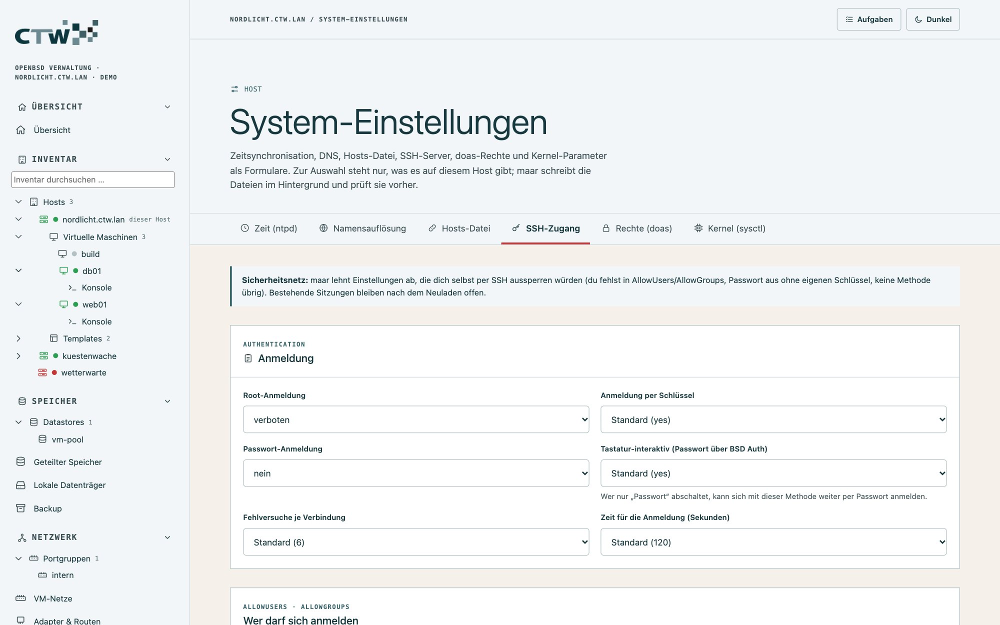

Root-Anmeldung, Anmeldemethoden (Passwort, Schlüssel, Tastatur-interaktiv), `AllowUsers`/`AllowGroups`
aus den Konten (mit Anzahl hinterlegter Schlüssel), Ports, `ListenAddress` aus den Host-Adressen,
Fehlversuche, Weiterleitungen, Protokollstufe.

**Schutz vor dem Aussperren.** maar lehnt Einstellungen ab, bei denen
- keine Anmeldemethode übrig bliebe,
- du selbst nicht mehr in `AllowUsers`/`AllowGroups` stündest,
- du die Passwort-Anmeldung abschaltest, ohne einen Schlüssel in `~/.ssh/authorized_keys` zu haben.

Geändert wird nur der globale Teil vor dem ersten `Match`; Match-Blöcke bleiben, und ein Hinweis nennt
sie. Bei geänderten Ports prüft maar, ob `pf.conf` sie erwähnt (`sshd -t` prüft die Syntax).

### Rechte (doas)

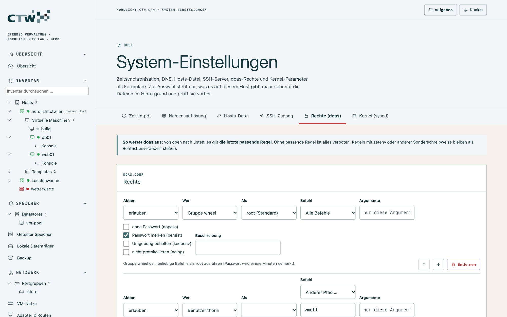

Regeln mit Auswahl für **Konto oder Gruppe** (`:wheel`), **Zielbenutzer**, **Befehl** (Programme, die es auf
dem Host gibt, oder ein Pfad), Argumente und die Optionen `nopass`, `persist`, `keepenv`, `nolog`. Unter
jeder Regel steht sie als deutscher Satz; die Reihenfolge bleibt erhalten, Kommentare wandern mit.
Regeln mit `setenv` bleiben als Rohtext unverändert. `doas -C` prüft vor dem Speichern.

Warnungen gibt es für `nopass` ohne Befehl, relative Befehle (doas vergleicht sie buchstäblich) und wenn du
dir selbst die Rechte entziehst.

### Kernel (sysctl)

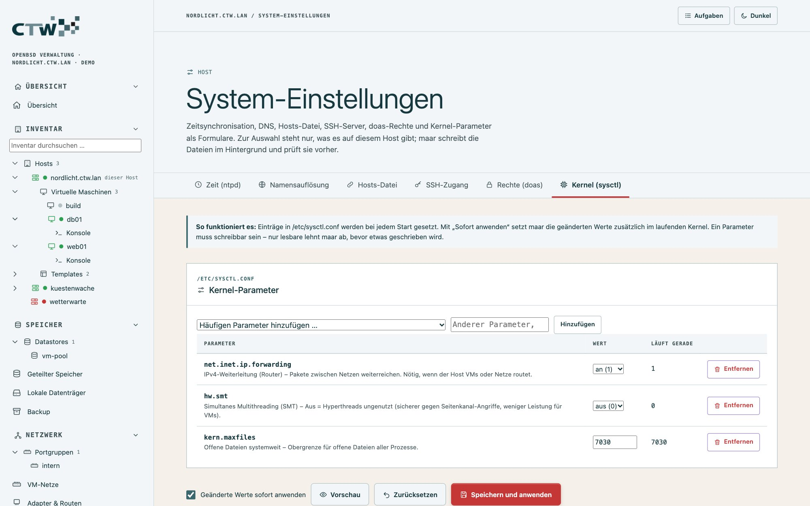

`/etc/sysctl.conf` als Tabelle. Zur Auswahl stehen die häufigen Parameter mit Beschreibung, Wertebereich
und Sicherheitshinweis – **nur, was der laufende Kernel kennt** (Weiterleitung `net.inet.ip.forwarding`,
`kern.somaxconn`, `kern.maxfiles`, Puffercache, SMT …) – und jeder andere Parameter über die Suche.

- Werte werden nach ihrer Art geprüft (0/1, Zahlenbereich, feste Auswahl, Zahl oder Text).
- Ein Parameter muss **schreibbar** sein; maar testet das vor dem Speichern mit einem wirkungslosen Setzen
  des aktuellen Werts.
- **Geänderte Werte sofort anwenden** setzt sie zusätzlich im laufenden Kernel; entfernte Einträge wirken bis
  zum Neustart nach.
- Riskante Parameter (`kern.securelevel`, `kern.allowkmem`, `machdep.allowaperture`, Source-Routing)
  lösen eine Warnung aus.

## Dienste

**Dienste → Systemdienste:** alle `rc.d`-Dienste mit Status; **Starten**, **Stoppen**, **Neu laden**,
**Neu starten**, **Aktivieren/Deaktivieren** (Start beim Booten) und **Flags** setzen. Der Filter „ausgefallen“
zeigt Dienste, die laufen sollten, aber nicht laufen (`rcctl ls failed`).

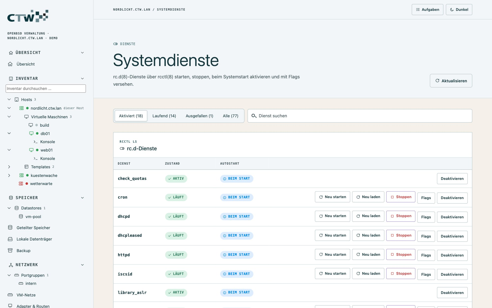

Aktionen, die den eigenen Zugang kappen könnten (z. B. `sshd` stoppen), warnen ausdrücklich.

## Pakete & Updates

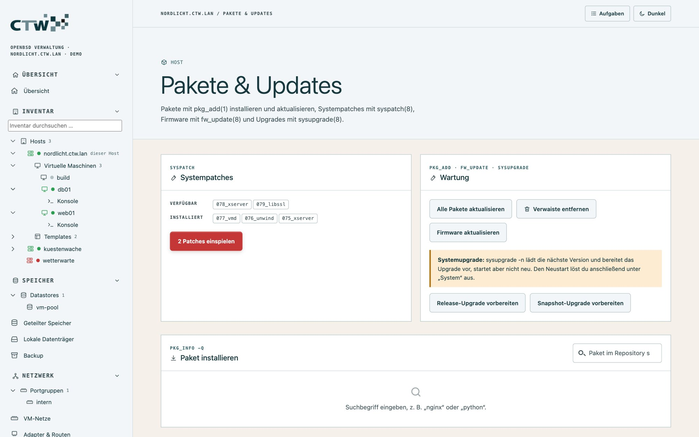

**Host → Pakete & Updates** deckt den ganzen Update-Weg ab:

| Aktion | Werkzeug |
|---|---|
| Systempatches anzeigen und einspielen | `syspatch` |
| Firmware aktualisieren | `fw_update` |
| Pakete suchen, installieren, entfernen | `pkg_add`, `pkg_delete`, `pkg_info` |
| Alle Pakete aktualisieren, Verwaiste entfernen | `pkg_add -u`, `pkg_delete -a` |
| Auf das nächste Release (ohne Neustart anstoßen) | `sysupgrade -n` |

Alle langen Vorgänge laufen als **Aufgaben** mit Live-Ausgabe (Schaltfläche **Aufgaben** oben rechts).
Nach einem `syspatch` kann ein Neustart nötig sein – die Ausgabe sagt es.

## Benutzer und Gruppen

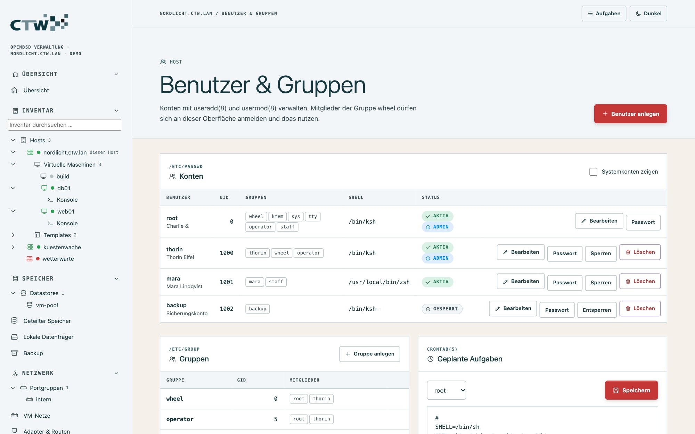

**Host → Benutzer & Gruppen:** Konten **anlegen**, bearbeiten (Shell, Gruppen, Heimverzeichnis), **Passwort setzen**,
**sperren**, **löschen**; Gruppen anlegen; die **crontab** eines Benutzers bearbeiten. Die Befehle darunter:
`useradd`, `usermod`, `encrypt`, `crontab`.

Wer sich bei maar anmelden darf, entscheidet die **Gruppe** (`wheel`) – nicht eine eigene Benutzerliste.
Was jemand dort darf, regeln [Rollen](08-zugriff-und-sicherheit.md#rollen-und-vm-eingrenzung).

## Web, Mail und Lastverteilung

**Dienste → Web, Mail & Lastverteilung** (nur Administratoren) hat vier Reiter. Gespeichert wird immer mit
Vorschau, Syntaxprüfung (`httpd -n`, `smtpd -n`, `relayd -n`), Sicherung und Neuladen; ist der Dienst
aus, bietet das Formular **aktivieren und starten** an.

### Webserver (httpd)

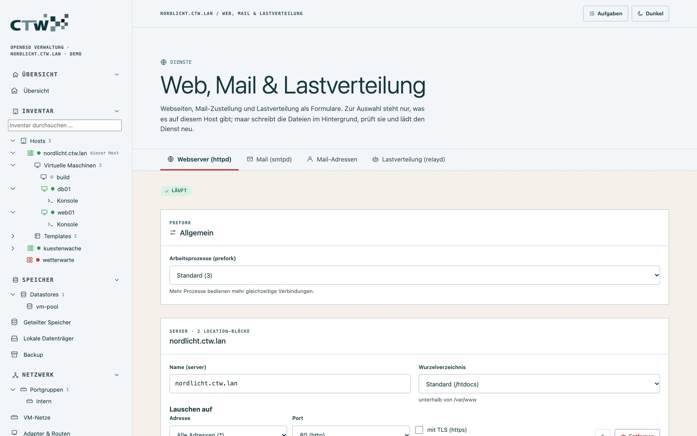

**Webseiten** (`server`-Blöcke): Name, Aliase, Adressen mit Port und TLS, Wurzelverzeichnis (Ordner unter
`/var/www/htdocs`), Zertifikat und Schlüssel aus `/etc/ssl`, Verzeichnisliste, Indexdatei, Protokollformat,
HSTS, Weiterleitung (`block return 30x`), `prefork`. `location`-Blöcke, `fastcgi`, `authenticate` u. ä.
bleiben wörtlich erhalten. **Webseite mit HTTPS hinzufügen** startet mit einer Vorlage.

### Mail (smtpd)

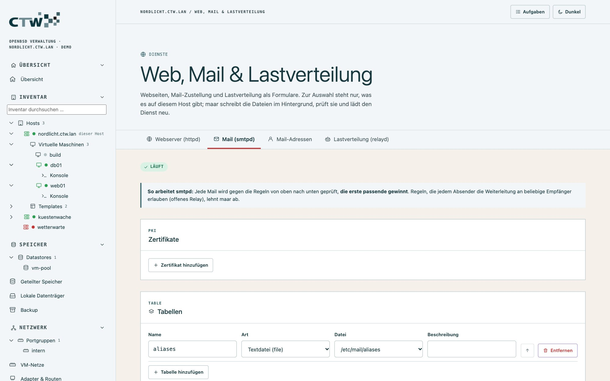

Zertifikate (`pki`), Tabellen (`table`, Dateien aus `/etc/mail`), **Annahme** (`listen on`: Schnittstelle,
Port, STARTTLS/smtps, Zertifikat, Anmeldung), **Zustellung** (`action`: mbox, Maildir, LMTP, Relay mit
Smarthost, TLS, Anmeldedaten) und **Regeln** (`match`, erste Treffer gewinnt, jede als deutscher Satz).

**Schutz:** Regeln, die jedem Absender die Weiterleitung an beliebige Empfänger erlauben (**offenes Relay**),
werden abgelehnt; Anmeldung braucht TLS; Tabellen, Zertifikate und Aktionen müssen existieren.

### Mail-Adressen

Die von smtpd verwendeten Dateitabellen als Tabelle: **Aliase** (`name: ziel, ziel`) und **virtuelle
Adressen** (`info@example.org ziel` oder `@example.org` für alle übrigen Adressen einer Domain). Ziele sind
lokale Benutzer (Auswahl) oder Mail-Adressen. maar lehnt Schleifen, unbekannte Ziele und das Entfernen
von `root` ab. Zeilen mit Befehl (`|…`), Datei oder `:include:` bleiben unverändert. Danach liest
`smtpctl update table` die Tabelle neu ein. Tabellen mit Passwort-Hashes werden **bewusst weder gelesen noch angezeigt**.

### Lastverteilung (relayd)

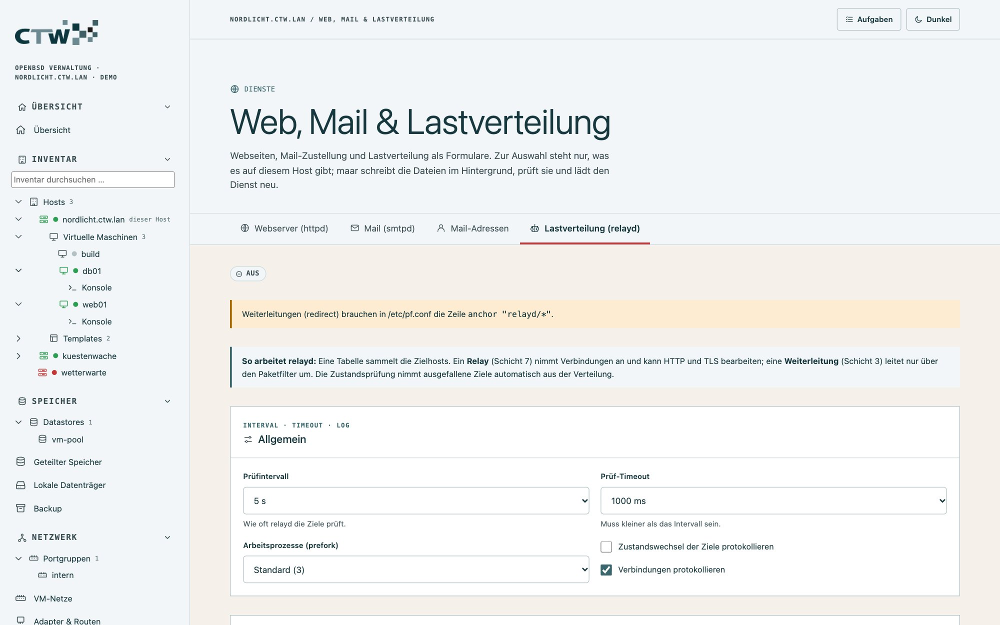

**Zieltabellen** mit Hosts (VM-Adressen per Auswahl, Wiederholungen bei Fehler), **Relays** (Schicht 7:
Adresse, Port, TLS, Protokoll, Zieltabelle, Verteilverfahren, Zustandsprüfung per Ping, TCP, TLS oder
HTTP-Abruf mit Pfad und Statuscode, Sitzungs-Timeout) und **Weiterleitungen** (Schicht 3, mit Portbereich
und `sticky-address`). Neue Protokolle entstehen aus Vorlagen (HTTP mit `X-Forwarded-For`, HTTPS mit
Schlüsselpaar aus `/etc/ssl`, TCP). Vorhandene Protokolle, Makros und Unbekanntes bleiben unverändert.
Hinweise gibt es zu fehlendem `anchor "relayd/*"` in `pf.conf`, TLS ohne Schlüsselpaar und nicht erlaubten Ports.

## Konfigurationsdateien als Text

Wer eine Datei lieber direkt bearbeitet: **Verwaltung → Konfigurationsdateien** (nur Administratoren) listet
24 freigegebene Dateien und alle `/etc/hostname.*`. Gespeichert wird mit **Syntaxprüfung** (`pfctl -nf`,
`vmd -n`, `httpd -n`, `doas -C`, `sshd -t` …), **Sicherung** und **Konflikterkennung** (wurde die Datei
inzwischen anders geändert?). Eine **Übernehmen**-Aktion lädt den Dienst anschließend neu.

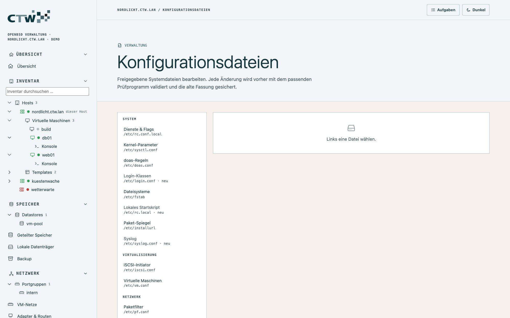

Noch ohne Formular, also nur als Text verfügbar: `bgpd.conf`, `iked.conf` und weitere Dienstdateien.

Weiter: [Überwachung und Alarme](07-ueberwachung.md).
