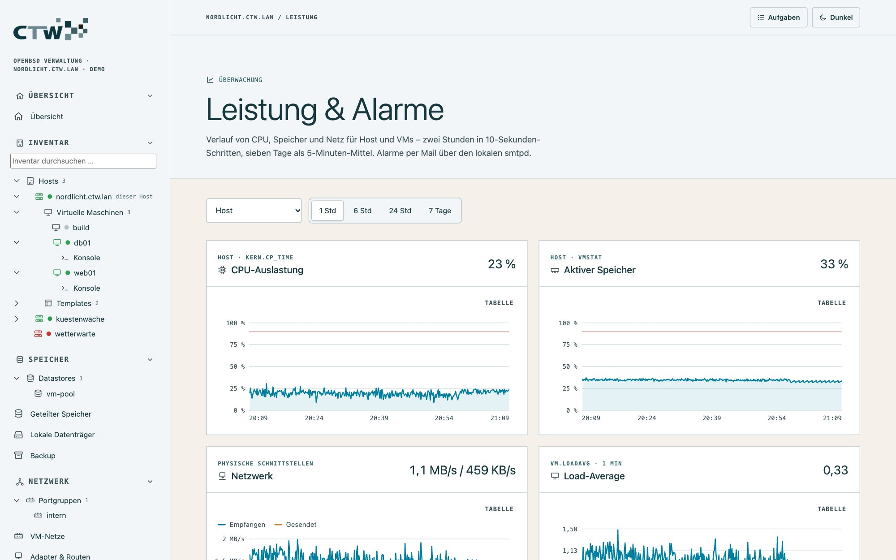
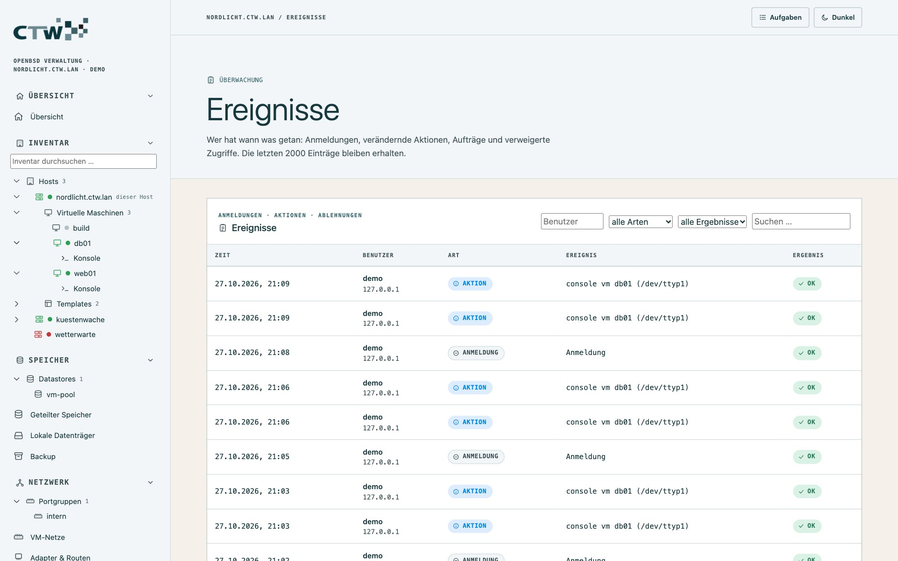
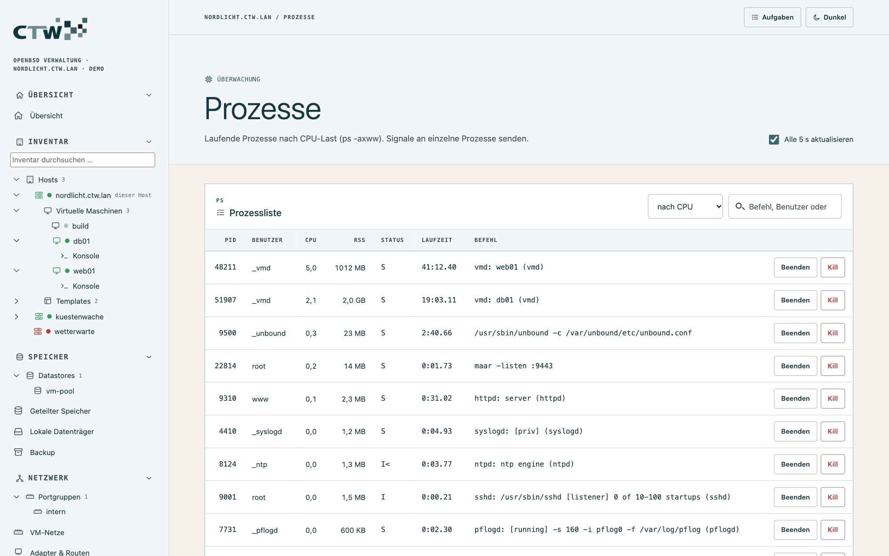
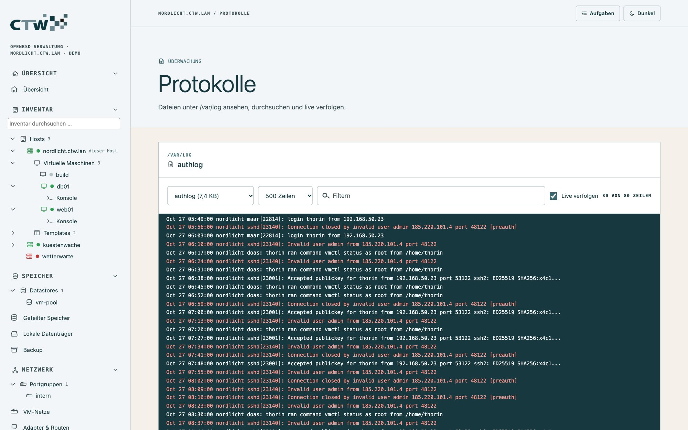

# 7 · Überwachung und Alarme

[← Host und Dienste](06-host-und-dienste.md) · [Dokumentation](README.md) · [Weiter: Zugriff und Sicherheit →](08-zugriff-und-sicherheit.md)

## Übersicht

Die Startseite zeigt den Zustand des Hosts auf einen Blick: CPU-Last, aktiven Speicher, Laufzeit, aktive
VMs, **ausgefallene Dienste** (mit Link zu den Diensten), Dateisysteme sowie Netz und Paketfilter.

## Leistung

**Überwachung → Leistung & Alarme** zeigt Verläufe für den Host (CPU, Speicher, Load, Netz) und je VM
(CPU, Speicher, Netz).

**So misst maar:** alle 10 Sekunden mit leichten Zählern (kein `top`): CPU aus `kern.cp_time`, aktiven
Speicher aus `vmstat -s`, Netz aus `netstat -ibn` (physische Interfaces bzw. der Tap einer VM, erkannt an
der Beschreibung `vmN-ifM-name`) und CPU/RSS der vmd-Prozesse aus `ps`. Minütlich kommen Dateisystembelegung
und ausgefallene Dienste hinzu.

- **Zeiträume:** 2 Stunden in 10-Sekunden-Schritten, 7 Tage als 5-Minuten-Mittel.
- **Speicherung:** Die Zeitreihen liegen im Speicher und werden alle 5 Minuten nach
  `/var/maar/metrics.json.gz` gesichert; ein Neustart von `maard` verliert also höchstens 5 Minuten.
- **Diagramme:** Tooltip beim Überfahren, **Tabelle**-Ansicht als Alternative.
- **Nicht verfügbar:** Disk-I/O je VM – vmd stellt sie nicht bereit.

## Alarmregeln und Mail

Auf derselben Seite (**Regeln**, **Benachrichtigung**, **Verlauf**) legst du fest, wann maar Alarm schlägt.

- **Regeln** vergleichen einen Messwert mit einem **Schwellwert** und lösen erst aus, wenn die Bedingung die
  **Mindestdauer** lang ununterbrochen gilt. Mit `*` gilt eine Regel für **jede VM** bzw. **jedes Dateisystem**.
- **Voreingestellt:** Host-CPU und -Speicher über 90 % für 5 Minuten, Dateisystem über 90 %, VM-CPU über 95 % für 15 Minuten.
- **Ereignisse** (unabhängig von Schwellwerten): Dienst ausgefallen, VM unerwartet gestoppt (Stopps über maar
  und Sicherungen zählen nicht), Sicherung fehlgeschlagen. Optional: „Zugriff verweigert“ und
  „Anmeldung fehlgeschlagen“ (standardmäßig aus).
- **Mail:** über `mail(1)` an den lokalen smtpd – an lokale Konten wie `root` oder an Adressen, sofern smtpd
  weiterleiten darf. Gleiche Meldungen gehen **höchstens alle 30 Minuten** hinaus.
  Der Button **Testmail senden** prüft die Zustellung.

> **Tipp:** Richte `root` in `/etc/mail/aliases` auf deine echte Adresse
> ([Mail-Adressen](06-host-und-dienste.md#mail-adressen)) und prüfe mit der Testmail, dass sie ankommt.
> Ein Alarm, der nirgends ankommt, ist keiner.

Konfiguration und Verlauf stehen in `/var/maar/alerts.json`.

## Ereignisse

**Überwachung → Ereignisse** ist das Ereignisprotokoll von maar: **Anmeldungen, Aktionen, Aufträge und
Ablehnungen**, filterbar. Die letzten 2000 Einträge bleiben erhalten (`/var/maar/events.jsonl`); jede Zeile
nennt Zeit, Benutzer, Art, Ereignis und Ergebnis. Das Ende von Aufträgen (Pakete, Backups, Netz) erscheint
als Ereignis „Auftrag beendet“ – mit Fehlertext, falls es fehlgeschlagen ist.

Alles steht zusätzlich im **Syslog** (`daemon.info`, Tag `maar`) – nützlich, wenn du es per `syslogd`
an einen Logserver weiterleitest.

## Prozesse

**Überwachung → Prozesse:** die Prozessliste (`ps`); Administratoren können einzelnen Prozessen **Signale**
(`kill`) senden. Das verlangt eine Bestätigung.

## Protokolle

**Überwachung → Protokolle:** Dateien aus `/var/log/` lesen, filtern und **live verfolgen** (Server-Sent
Events, wie `tail -f`).

Typische Dateien: `messages` (Systemmeldungen), `daemon` (Dienste, auch maar), `authlog` (Anmeldungen und
`doas`), `pflog` (nur mit `pflogd`), `maillog`, `xferlog`.

Weiter: [Zugriff und Sicherheit](08-zugriff-und-sicherheit.md).
