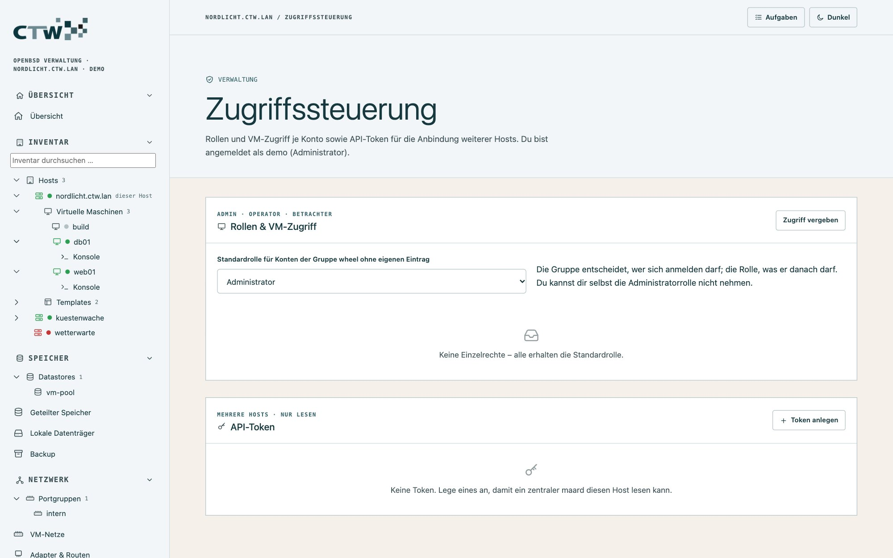
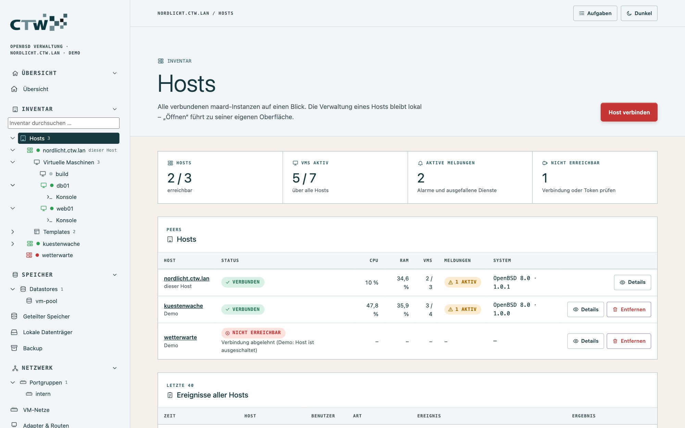
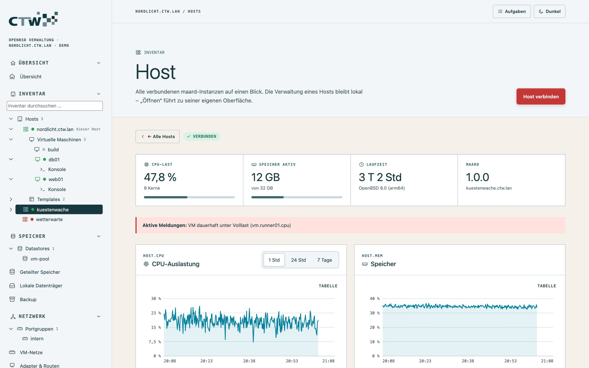

# 8 · Zugriff und Sicherheit

[← Überwachung und Alarme](07-ueberwachung.md) · [Dokumentation](README.md) · [Weiter: Betrieb und Fehlersuche →](09-betrieb.md)

## Wer darf was?

Zwei Ebenen entscheiden:

1. **Anmelden darf**, wer Mitglied der Gruppe `-group` ist (Standard `wheel`) und das richtige
   Systempasswort kennt (BSD Auth, `login_passwd`).
2. **Was danach erlaubt ist**, bestimmt die **Rolle**. Konten ohne Eintrag erhalten die Standardrolle
   (anfangs *Administrator*).

## Rollen und VM-Eingrenzung

**Verwaltung → Zugriffssteuerung** (nur Administratoren):



| Rolle | Darf |
|---|---|
| **Administrator** | alles |
| **Operator** | lesen; **zugewiesene** VMs starten, herunterfahren, pausieren, per Konsole bedienen; Snapshots anlegen und zurücksetzen |
| **Betrachter** | nur lesen – ohne Konfigurationsdateien, Schlüssel, Konsolen (auch VM-Konsolen, weil interaktiv) und Rollenverwaltung |

Zusätzlich lässt sich ein Konto auf **bestimmte VMs eingrenzen**. Es sieht dann in Liste, Baum und
Portgruppen nur diese VMs und kann nur auf sie zugreifen (die Übersicht nennt weiterhin alle Namen).

**Beispiele**

- *Entwickler-Team:* Rolle Operator, eingegrenzt auf `build`, `runner01`, `runner02`. Sie dürfen die
  Runner starten und stoppen, aber keine Firewall ändern.
- *Auditor:* Rolle Betrachter – sieht alles, ändert nichts.

**Sicherung gegen Fehler:** Eine Änderung der eigenen Rolle, die dir den Administrator-Zugriff entzieht,
wird abgelehnt.

> **Gut zu wissen:** Rollen schränken die **Oberfläche** ein, nicht das Betriebssystem. Wer SSH-Zugang
> mit `doas`-Rechten hat, kann auf dem Host trotzdem alles. Rechte auf Systemebene vergibst du mit
> [doas](06-host-und-dienste.md#rechte-doas).

## Ereignisprotokoll

Jede Anmeldung, verändernde Aktion und verweigerte Anfrage landet im [Ereignisprotokoll](07-ueberwachung.md#ereignisse)
und im Syslog – mit Benutzer und Quelladresse. Für „Zugriff verweigert“ und „Anmeldung fehlgeschlagen“
lassen sich Mail-Alarme einschalten.

## Mehrere Hosts

maar ist **kein Cluster**: Jeder Host betreibt sein eigenes `maard` und wird **lokal** verwaltet. Ein
beliebiger Host dient als **Zentrale** und fragt die anderen (Peers) **lesend** ab – VMs, Leistung und
Ereignisse aller Hosts in einer Übersicht.



### Einen Peer verbinden

1. **Auf dem Peer:** **Verwaltung → Zugriffssteuerung → API-Token → Token anlegen.** Das Token wird
   **nur einmal** angezeigt; gespeichert wird nur sein SHA-256-Wert.
2. **In der Zentrale:** **Inventar → Hosts → Host verbinden.** Adresse (`https://peer:9443`), Name und Token
   eintragen und den **Fingerabdruck** des Zertifikats holen.
3. **Fingerabdruck vergleichen** mit dem Zertifikat des Peers (auf dem Peer:
   `openssl x509 -in /etc/ssl/maar.crt -noout -fingerprint -sha256`) und bestätigen.

Ändert sich das Zertifikat später, meldet die Zentrale **„Zertifikat geändert“**, statt blind zu vertrauen.



Die Detailseite eines Peers zeigt Kennzahlen, Verlauf und seine VMs. **Öffnen** führt zur lokalen
Oberfläche des Peers – dort verwaltest du ihn.

### Was die Zentrale darf – und was nicht

- API-Token dürfen **nur lesen**: die Zusammenfassung und die Messwerte (alles andere: 403). Fehlversuche
  zählen in die Anmeldesperre.
- Peers werden **nur über https** angesprochen (http nur auf Loopback), ohne Zugangsdaten in der URL.
- Die Zentrale speichert Peer-Token in `/var/maar/peers.json` (Modus 0600) und zeigt sie nie wieder an.
- Abfragen laufen parallel mit 6 s Zeitlimit und 10 s Zwischenspeicher; **ein ausgefallener Peer stört die
  übrigen nicht**.
- **Verwaltungsaktionen** (VMs starten, Rollen, Konfiguration) gibt es über die Zentrale **bewusst nicht** –
  dafür ist jeder Host selbst zuständig. VM-Migration zwischen Hosts gibt es ebenfalls nicht.

## TLS-Zertifikat

Beim ersten Start erzeugt maar ein selbst signiertes Zertifikat. Für den Dauerbetrieb nimm ein
eigenes – z. B. von `acme-client` (Let's Encrypt) oder deiner internen CA – und gib es beim Start an:

```sh
rcctl set maard flags -listen 192.168.50.10:9443 -cert /etc/ssl/verwaltung.example.org.fullchain.pem -key /etc/ssl/private/verwaltung.example.org.key
rcctl restart maard
```

Ein Zertifikat über `acme-client` richtest du so ein (Kurzfassung; die Details stehen in `man acme-client.conf`):

1. In `/etc/acme-client.conf` eine `domain`-Sektion für den Hostnamen anlegen.
2. Die HTTP-Challenge muss erreichbar sein (z. B. über `httpd`, siehe [Webserver](06-host-und-dienste.md#webserver-httpd)).
3. `acme-client -v verwaltung.example.org` ausführen und per `cron` regelmäßig erneuern, danach
   `rcctl restart maard`.

Peers mit selbst signiertem Zertifikat funktionieren weiter über den bestätigten Fingerabdruck.

## Härtung: Empfehlungen

1. **Nur im Verwaltungsnetz erreichbar machen** – pf-Regel oder `-listen` auf eine interne Adresse
   ([Beispiel](04-netzwerk-und-firewall.md#firewall-absichern-ein-beispiel)). Die Oberfläche gehört nie ins offene Internet.
2. **Eigenes TLS-Zertifikat** statt des selbst signierten.
3. **Rollen vergeben:** Administrator nur für Personen, die Konfiguration ändern; sonst Operator oder Betrachter.
4. **SSH auf Schlüssel umstellen** ([SSH-Zugang](06-host-und-dienste.md#ssh-zugang)).
5. **Updates:** `syspatch` regelmäßig, maar bei neuen Releases aktualisieren ([Betrieb](09-betrieb.md#maar-aktualisieren)).
6. **Alarme einrichten** und die Testmail prüfen ([Alarmregeln](07-ueberwachung.md#alarmregeln-und-mail)).
7. **Backups wiederherstellen üben** ([Backup](05-speicher-und-backup.md#wiederherstellen)).

## Wie maar selbst abgesichert ist

- **Läuft als root** (Systemverwaltung und BSD Auth brauchen das) und schränkt sich nach dem Start mit
  `pledge(2)` ein. Gestartete Werkzeuge laufen ohne zusätzliche Einschränkung.
- **Keine Shell:** Alle Systemaufrufe gehen über Argumentlisten; jeder Name, Pfad und jede Größe wird vorher
  gegen eine Positivliste geprüft. Pfade für Disk-Images und ISOs müssen unter `-vmdir` liegen,
  Konfigurationsdateien müssen freigegeben sein.
- **Sitzungen:** zufälliges 256-Bit-Token im Cookie (`HttpOnly`, `Secure`, `SameSite=Strict`), 30 Minuten
  Leerlauf, maximal 12 Stunden. Jede schreibende Anfrage verlangt zusätzlich ein **CSRF-Token**;
  WebSockets prüfen den Origin.
- **Anmeldesperre:** 5 Fehlversuche je Quelladresse in 5 Minuten, danach Sperre.
- **Strenge Content-Security-Policy** (`script-src 'self'`), keine Inline-Skripte; Ausgaben des Systems
  werden nur als Text ins DOM gesetzt.
- **Bestätigungswörter** bei gefährlichen Aktionen (VM löschen, pf aus, Neustart, Snapshot-Upgrade);
  Aktionen, die den eigenen Zugang kappen könnten, warnen ausdrücklich.
- **Host-Shell** als angemeldeter Benutzer (`su -l`), nicht als root.

Weiter: [Betrieb und Fehlersuche](09-betrieb.md).
