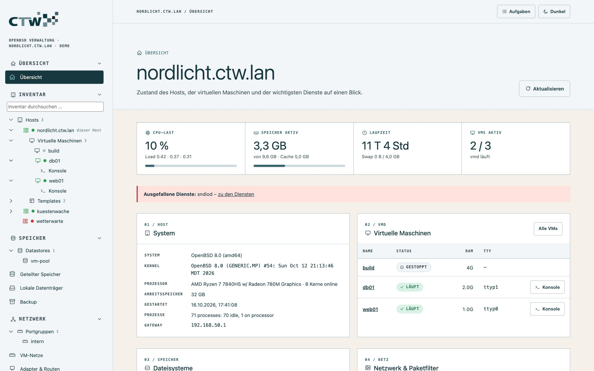

# maar – Dokumentation

maar ist die webbasierte Verwaltung für OpenBSD: virtuelle Maschinen (vmd), Speicher, Netzwerk, Dienste
und Host in einer Oberfläche. Diese Dokumentation führt von der Installation bis zum Betrieb mehrerer
Hosts – für erfahrene Administratoren ebenso wie für alle, die gerade in OpenBSD einsteigen.

## Wo fange ich an?

| Du bist … | Lies zuerst |
|---|---|
| neu bei OpenBSD oder Virtualisierung | [2 · Grundlagen für Einsteiger](02-grundlagen.md), danach [1 · Erste Schritte](01-erste-schritte.md) |
| erfahrener Admin (vSphere, KVM, Proxmox) | [1 · Erste Schritte](01-erste-schritte.md), danach [3 · Virtuelle Maschinen](03-virtuelle-maschinen.md) |
| unterwegs zu einer bestimmten Aufgabe | die Tabelle „Aufgaben“ unten |
| für den Betrieb zuständig | [8 · Zugriff und Sicherheit](08-zugriff-und-sicherheit.md) und [9 · Betrieb](09-betrieb.md) |

## Inhalt

1. [Erste Schritte](01-erste-schritte.md) – installieren, anmelden, die Oberfläche kennenlernen
2. [Grundlagen für Einsteiger](02-grundlagen.md) – OpenBSD, vmd, pf und doas in zehn Minuten; Glossar; die erste VM Schritt für Schritt
3. [Virtuelle Maschinen](03-virtuelle-maschinen.md) – anlegen, bedienen, Konsole, Templates, Klone, Snapshots
4. [Netzwerk und Firewall](04-netzwerk-und-firewall.md) – Portgruppen, VLANs, DHCP/DNS, Firewall je VM, Schnittstellen, pf
5. [Speicher und Backup](05-speicher-und-backup.md) – Datastores, iSCSI, Fibre Channel, Sicherungen, Wiederherstellen
6. [Host und Dienste](06-host-und-dienste.md) – System-Einstellungen per Formular, Dienste, Pakete, Benutzer, Web und Mail
7. [Überwachung und Alarme](07-ueberwachung.md) – Leistung, Alarmregeln, Ereignisse, Protokolle
8. [Zugriff und Sicherheit](08-zugriff-und-sicherheit.md) – Rollen, mehrere Hosts, TLS, Härtung
9. [Betrieb und Fehlersuche](09-betrieb.md) – Update, Datensicherung von maar selbst, typische Probleme
10. [Referenz](10-referenz.md) – Dateien und Pfade, Startoptionen, Menü und Befehle im Vergleich

## Aufgaben

| Ich möchte … | Anleitung |
|---|---|
| maar installieren oder aktualisieren | [Erste Schritte](01-erste-schritte.md#installation) |
| eine VM aus einer ISO-Datei anlegen | [Die erste VM](02-grundlagen.md#die-erste-vm-schritt-für-schritt) |
| viele gleiche VMs schnell bereitstellen | [Templates und Klone](03-virtuelle-maschinen.md#templates-und-klone) |
| VMs ins eigene Netz mit DHCP und DNS legen | [Portgruppen anlegen](04-netzwerk-und-firewall.md#portgruppen-anlegen) |
| eine Firewall-Regel setzen, ohne mich auszusperren | [Paketfilter auf Probe](04-netzwerk-und-firewall.md#paketfilter-regeln-auf-probe) |
| VMs regelmäßig sichern | [Backup-Jobs](05-speicher-und-backup.md#backup) |
| SAN-Speicher (iSCSI) einbinden | [iSCSI und Datastores](05-speicher-und-backup.md#iscsi-ziele-einbinden) |
| SSH, NTP, DNS oder sysctl ändern | [System-Einstellungen](06-host-und-dienste.md#system-einstellungen-per-formular) |
| einen Webserver oder Mailserver einrichten | [Web, Mail und Lastverteilung](06-host-und-dienste.md#web-mail-und-lastverteilung) |
| Kollegen mit eingeschränkten Rechten Zugriff geben | [Rollen](08-zugriff-und-sicherheit.md#rollen-und-vm-eingrenzung) |
| mehrere Hosts in einer Übersicht sehen | [Mehrere Hosts](08-zugriff-und-sicherheit.md#mehrere-hosts) |
| ein eigenes TLS-Zertifikat verwenden | [TLS-Zertifikat](08-zugriff-und-sicherheit.md#tls-zertifikat) |
| herausfinden, warum etwas nicht geht | [Fehlersuche](09-betrieb.md#fehlersuche) |

## Screenshots

Alle Bilder stammen aus dem Demo-Modus (`make demo`), 1600 × 1000 Pixel bei 1,25-facher Dichte
(2000 × 1250 Bildpunkte). Sie lassen sich mit `node docs/tools/screenshots.mjs` neu erzeugen, wenn die
Oberfläche sich ändert (siehe [Betrieb](09-betrieb.md#dokumentation-und-screenshots-pflegen)).

Hinweis zur Genauigkeit: maar wurde gegen nachgebildete OpenBSD-8.0-Ausgaben getestet; ein Lauf auf
echter Hardware steht noch aus. Die Anleitungen beschreiben das Verhalten, das auch die Tests
sicherstellen. Auffälligkeiten bitte als Issue auf GitHub melden.
